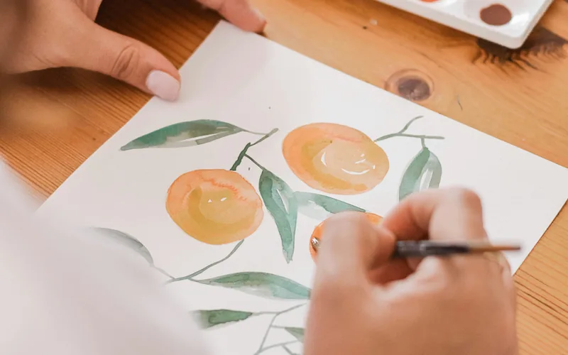
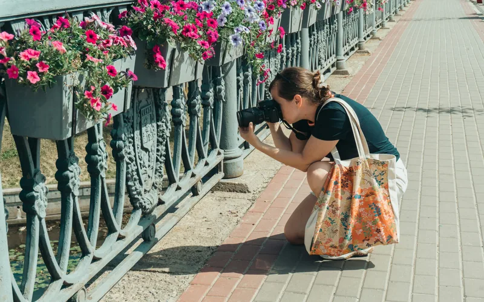
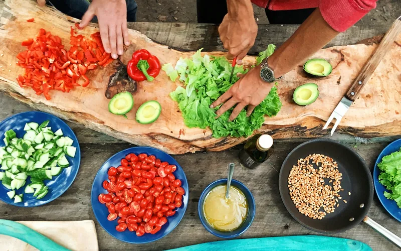

# Soosh content batch 1

Draft for editorial review. 30 activities and 10 generic Pursuit templates across 10 existing Corners. Nothing has been published or attached to a member account.

Times are estimates including setup, excluding shopping and travel. Costs are unknown, not assumed free. Images and external references still need selection and verification.

## Drawing

Cover photo still to source: Hands drawing an everyday object with a pencil on plain paper. A real drawing activity, not a painting setup.
Existing Corner: `art-creative/drawing`

### Draw what is in your pocket
Put a few everyday objects on a table and make a small drawing of them.

**Estimated time:** 10 to 15 minutes. **Setting:** home, outdoors. **Company:** on your own or with someone.

1. Choose 2 or 3 objects you already have.
2. Draw their outlines, then add one detail that makes each object recognizable.
3. Choose one object and draw it again from another side.

**Required:** Paper; Pencil or pen.
**Cost:** No paid venue is required. Supplies, equipment, digital access or travel may cost extra; check what you already have.
**With someone:** Compare the objects you each chose, or draw the same arrangement.

### Draw a room with one continuous line
Keep your pen moving as you draw part of a room.

**Estimated time:** 10 to 15 minutes. **Setting:** home. **Company:** on your own or with someone.

1. Choose one corner of a room and a place to sit.
2. Draw what you see without lifting your pen. Leave mistakes in the picture.
3. Start a second version and follow a different route through the same scene.

**Required:** Paper; Pen.
**Cost:** No paid venue is required. Supplies, equipment, digital access or travel may cost extra; check what you already have.
**With someone:** Sit in different places and compare how the room looks from each one.

### Make a tiny texture collection
Fill a page with small drawings of textures you can find nearby.

**Estimated time:** 15 to 25 minutes. **Setting:** home, outdoors. **Company:** on your own or with someone.

1. Divide a page into 6 small boxes.
2. Look for textures such as fabric, bark, tiles or a leaf. Draw one in each box.
3. Choose one box and make a larger version using the same marks.

**Required:** Paper; Pencil or pen.
**Cost:** No paid venue is required. Supplies, equipment, digital access or travel may cost extra; check what you already have.
**With someone:** Each person contributes a few boxes to one shared page.

### Pursuit: Make a small drawing collection
Make 6 drawings of ordinary things, using a few different ways of looking.

**Finish line:** 6 drawings you choose to keep.
Try one small step, then choose whether and when to continue. No deadline is required.

1. **Choose 3 subjects.** Pick objects or views you can return to without buying anything.
2. **Draw each subject twice.** Try a different line or viewpoint on the second version.
3. **Choose your collection.** Put 6 drawings together. Add titles if you want.

## Painting

Corner cover photo: [Sincerely Media](https://unsplash.com/photos/s3tPywNsLSo). Illustrative cover; not an image of every step.
Existing Corner: `art-creative/painting`

### Mix a page of colors
See how many colors you can mix from the paints you already have.

**Estimated time:** 20 to 30 minutes. **Setting:** home. **Company:** on your own or with someone.

1. Protect the table and set out a small amount of paint.
2. Mix pairs of colors and paint a swatch of each mixture.
3. Pick 3 mixtures and use them to paint a small shape or object.

**Required:** Paintbrush; Water container; Protected work surface.
**Choose one setup:** Watercolors and watercolor paper (Watercolor paints, Watercolor paper); or Gouache and suitable paper (Gouache paints, Paper suitable for gouache).
**Cost:** No paid venue is required. Supplies, equipment, digital access or travel may cost extra; check what you already have.
**With someone:** Use the same starting colors and compare the mixtures you make.

### Paint a leaf with two colors
Look closely at one leaf and paint its shape with a limited palette.

**Estimated time:** 20 to 35 minutes. **Setting:** home. **Company:** on your own or with someone.

1. Choose a leaf you can examine without damaging a plant.
2. Paint its outline and large areas using 2 colors.
3. Add a few veins or shadows after the first layer has dried enough for your paint.

**Required:** Paintbrush; Water container; Protected work surface; A leaf or a reference photo you took.
**Choose one setup:** Watercolors and watercolor paper (Watercolor paints, Watercolor paper); or Gouache and suitable paper (Gouache paints, Paper suitable for gouache).
**Cost:** No paid venue is required. Supplies, equipment, digital access or travel may cost extra; check what you already have.
**With someone:** Paint the same leaf separately, or each choose a different leaf.

### Paint a postcard-sized view
Make a small painting of the view from a window.

**Estimated time:** 30 to 50 minutes. **Setting:** home. **Company:** on your own or with someone.

1. Choose a window view and a small piece of suitable paper.
2. Block in the largest shapes before adding details.
3. Choose one detail to finish, then leave the painting to dry.

**Required:** Paintbrush; Water container; Protected work surface.
**Optional:** Tape for holding paper in place.
**Choose one setup:** Watercolors and watercolor paper (Watercolor paints, Watercolor paper); or Gouache and suitable paper (Gouache paints, Paper suitable for gouache).
**Cost:** No paid venue is required. Supplies, equipment, digital access or travel may cost extra; check what you already have.
**With someone:** Choose the same view and compare which details caught your attention.

### Pursuit: Make a set of small paintings
Use subjects you can find at home to make 4 small paintings.

**Finish line:** 4 completed small paintings.
Try one small step, then choose whether and when to continue. No deadline is required.

1. **Try your materials.** Make a few color swatches and choose a small painting surface.
2. **Make 4 paintings.** Use a different subject or color combination for each one.
3. **Bring them together.** Let the paintings dry and choose an order for the set.

## Reading

Corner cover photo: [Sergei Nikulin](https://unsplash.com/photos/tglfT2WsX8E). Illustrative cover; not an image of every step.
Existing Corner: `books-writing/reading`

### Read the opening of a book you already own
Give an unread book a short first try.

**Estimated time:** 15 to 20 minutes. **Setting:** home, outdoors. **Company:** on your own or with someone.

1. Pick a book you can access now.
2. Read its opening for about 15 minutes.
3. Mark your place and decide whether you want another session with this book.
**Optional:** Bookmark.
**Choose one setup:** Print book (Print book); or Digital book (Device, Accessible digital book).
**Cost:** No paid venue is required. Supplies, equipment, digital access or travel may cost extra; check what you already have.
**With someone:** Each read your own opening, then tell the other person whether you want to continue.

### Read a short story in one sitting
Choose a story short enough to finish in the time you have.

**Estimated time:** 20 to 40 minutes. **Setting:** home, outdoors. **Company:** on your own or with someone.

1. Choose a short story you already have access to.
2. Read to the end, with breaks if you need them.
3. Pick one scene or sentence you would like to return to.
**Choose one setup:** Printed story (Printed short story); or Digital story (Device, Accessible digital short story).
**Cost:** No paid venue is required. Supplies, equipment, digital access or travel may cost extra; check what you already have.
**With someone:** Read the same story separately, then compare which part stayed with you.

### Read the same passage in two ways
Try a passage silently, then hear how it sounds aloud.

**Estimated time:** 15 to 25 minutes. **Setting:** home. **Company:** on your own or with someone.

1. Choose a short passage from a book you can access.
2. Read it silently, then read it aloud somewhere you can do so comfortably.
3. Notice where you pause or change your voice. Read it once more if you want.
**Choose one setup:** Print book (Print book); or Digital book (Device, Accessible digital book).
**Cost:** No paid venue is required. Supplies, equipment, digital access or travel may cost extra; check what you already have.
**With someone:** Take turns reading, or listen to each person read the passage they chose.
**Keep in mind:** For reading aloud, choose a place where speaking will not disturb others.

### Pursuit: Finish a book you keep meaning to read
Choose a book, make space for a few reading sessions and work toward its final page.

**Finish line:** One book finished, if you decide to keep reading it.
Try one small step, then choose whether and when to continue. No deadline is required.

1. **Choose the book.** Try a few pages. Choose a different book if this one is not right for you.
2. **Find your way through it.** Choose a manageable section for each session and keep your place.
3. **Reach the final page.** Finish the book and decide what, if anything, you want to read next.

## Writing

Cover photo still to source: A person drafting a story on paper or a laptop, with the writing surface clearly visible. No readable personal information.
Existing Corner: `books-writing/writing`

### Write a scene around a lost object
Start with someone finding an object they were not looking for.

**Estimated time:** 15 to 25 minutes. **Setting:** home, outdoors. **Company:** on your own or with someone.

1. Choose an object and a place where it could be found.
2. Write what happens when someone picks it up.
3. End the scene with a choice the person has to make.
**Choose one setup:** On paper (Paper, Pen or pencil); or On a device (Device, Text editor).
**Cost:** No paid venue is required. Supplies, equipment, digital access or travel may cost extra; check what you already have.
**With someone:** Write different versions of the same starting scene, then share only if you want to.

### Write a conversation without explanations
Let two characters disagree through what they say.

**Estimated time:** 15 to 20 minutes. **Setting:** home. **Company:** on your own or with someone.

1. Choose something small for 2 characters to disagree about.
2. Write their conversation without explaining their feelings between lines.
3. Read it aloud and change any line that does not sound like the person speaking.
**Choose one setup:** On paper (Paper, Pen or pencil); or On a device (Device, Text editor).
**Cost:** No paid venue is required. Supplies, equipment, digital access or travel may cost extra; check what you already have.
**With someone:** Each write one character’s lines, or compare two separate conversations.

### Rewrite one scene from another viewpoint
Take a scene you wrote and tell it through someone else in it.

**Estimated time:** 20 to 30 minutes. **Setting:** home. **Company:** on your own or with someone.

1. Choose a short scene you have written.
2. Pick a different character and write what they notice.
3. Compare the versions and choose which one serves your story.

**Required:** A short scene you wrote.
**Choose one setup:** On paper (Paper, Pen or pencil); or On a device (Device, Text editor).
**Cost:** No paid venue is required. Supplies, equipment, digital access or travel may cost extra; check what you already have.
**With someone:** Each take a different viewpoint on a scene you created together.

### Pursuit: Finish a short story
Start with one scene and build a short story you can read from beginning to end.

**Finish line:** One finished short story of a length you choose.
Try one small step, then choose whether and when to continue. No deadline is required.

1. **Find a scene.** Choose a character, a place and something the character wants.
2. **Write a first version.** Give the story a beginning, a change and an ending.
3. **Read and revise.** Read the whole story and change the parts that do not say what you meant.

## Photography

Corner cover photo: [Alex Gorin](https://unsplash.com/photos/31KvOn6d818). Illustrative cover; not an image of every step.
Existing Corner: `photography-film/photography`

### Photograph five shades of one color
Look for variations of one color around your home or on a short route.

**Estimated time:** 20 to 35 minutes. **Setting:** home, outdoors. **Company:** on your own or with someone.

1. Choose a color and decide where you can look for it.
2. Photograph 5 examples, paying attention to light and shade.
3. Choose an order that shows the differences between them.
**Choose one setup:** Phone camera (Phone with a camera); or Camera (Camera).
**Cost:** No paid venue is required. Supplies, equipment, digital access or travel may cost extra; check what you already have.
**With someone:** Pick the same color and compare what each person found.
**Keep in mind:** Photograph things you can access. Ask before including identifiable people.

### Make an ordinary object look unfamiliar
Use close framing and unusual angles to change how an object looks.

**Estimated time:** 15 to 25 minutes. **Setting:** home. **Company:** on your own or with someone.

1. Choose an object you can move or walk around.
2. Photograph details from close up and from several angles.
3. Pick 3 frames that show the object in different ways.

**Required:** One everyday object.
**Choose one setup:** Phone camera (Phone with a camera); or Camera (Camera).
**Cost:** No paid venue is required. Supplies, equipment, digital access or travel may cost extra; check what you already have.
**With someone:** Take turns choosing an object for the other person to photograph.
**Keep in mind:** Photograph things you can access. Ask before including identifiable people.

### Photograph light in one small space
Make a short photo set using the available light near one window.

**Estimated time:** 20 to 30 minutes. **Setting:** home. **Company:** on your own or with someone.

1. Choose a small area with daylight and something to photograph.
2. Move your subject or change your position to try side light, back light and shade.
3. Keep one image from each setup and compare the shadows.

**Required:** A subject you can move; A space with daylight.
**Choose one setup:** Phone camera (Phone with a camera); or Camera (Camera).
**Cost:** No paid venue is required. Supplies, equipment, digital access or travel may cost extra; check what you already have.
**With someone:** One person moves the subject while the other photographs it, then swap.
**Keep in mind:** Photograph things you can access. Ask before including identifiable people.

### Pursuit: Make a photo set about one ordinary thing
Choose a subject and make a set of 8 photographs that show different sides of it.

**Finish line:** A selected set of 8 photos.
Try one small step, then choose whether and when to continue. No deadline is required.

1. **Choose a subject.** Pick something you can photograph more than once without special access.
2. **Try different approaches.** Change your distance, angle, framing or available light.
3. **Make the final selection.** Choose 8 photos that belong together and put them in an order.

## Cooking

Corner cover photo: [Maarten van den Heuvel](https://unsplash.com/photos/EzH46XCDQRY). Illustrative cover; not an image of every step.
Existing Corner: `food-cooking/cooking`

### Make a chickpea salad from what you have
Use ready-to-eat chickpeas and vegetables to put together a simple meal.

**Estimated time:** 20 to 30 minutes. **Setting:** home. **Company:** on your own or with someone.

1. Drain ready-to-eat canned chickpeas and wash the vegetables you choose.
2. Chop the vegetables and mix them with the chickpeas.
3. Add a dressing you like, taste, and adjust the seasoning.

**Required:** Ready-to-eat canned chickpeas; Vegetables suitable for eating raw; Dressing ingredients that suit your dietary needs; Bowl; Knife; Chopping board; Clean water.
**Optional:** Bread or another accompaniment.
**Cost:** No paid venue is required. Supplies, equipment, digital access or travel may cost extra; check what you already have.
**With someone:** Divide the chopping and mixing, then choose the final seasoning together.

### Cook a small pot of tomato beans
Make a warm dish with ready-cooked beans and canned tomatoes.

**Estimated time:** 25 to 40 minutes. **Setting:** home. **Company:** on your own or with someone.

1. Drain a can of ready-cooked beans and put them in a small saucepan with canned tomatoes.
2. Add seasoning you like and simmer gently, stirring, until the mixture is hot throughout and as thick as you want.
3. Taste and adjust. Serve with an accompaniment you already have.

**Required:** Ready-cooked canned beans; Canned tomatoes; Seasonings that suit your dietary needs; Saucepan; Spoon; Working stove.
**Optional:** Bread or another accompaniment.
**Cost:** No paid venue is required. Supplies, equipment, digital access or travel may cost extra; check what you already have.
**With someone:** One person handles the pan while the other prepares the accompaniment.

### Roast a tray of vegetables you will actually eat
Choose a few vegetables and use a tested roasting guide for them.

**Estimated time:** 40 to 60 minutes. **Setting:** home. **Company:** on your own or with someone.

1. Choose vegetables, wash them and cut them into sizes suited to the roasting guide you are following.
2. Use a reputable recipe or appliance guide for the oven temperature, tray and cooking time.
3. Roast until cooked, checking carefully with oven protection. Taste and adjust the seasoning.

**Required:** Vegetables; Oil and seasonings that suit your dietary needs; Knife; Chopping board; Oven; Oven-safe tray; Oven protection; A tested roasting guide for the chosen vegetables.
**Cost:** No paid venue is required. Supplies, equipment, digital access or travel may cost extra; check what you already have.
**With someone:** Choose the vegetables together and share the preparation. One person handles the hot tray.

### Pursuit: Build a small recipe collection
Make 3 simple dishes and keep the versions you would cook again.

**Finish line:** 3 dishes cooked, with your own usable instructions.
Try one small step, then choose whether and when to continue. No deadline is required.

1. **Choose 3 dishes.** Check the ingredients, kitchen equipment and dietary needs first.
2. **Cook each dish.** Follow a suitable recipe or the simple activity instructions and note any changes.
3. **Keep the useful versions.** Write down enough detail to make each dish again.

## Guitar

Corner cover photo: [Parker Coffman](https://unsplash.com/photos/GgsG8aNLgjQ). Illustrative cover; not an image of every step.
Existing Corner: `music/guitar`

### Make a two-note guitar pattern
Use two comfortable notes to make a short repeating pattern.

**Estimated time:** 15 to 20 minutes. **Setting:** home. **Company:** on your own or with someone.

1. Tune the guitar with a tuner you already have access to.
2. Choose 2 notes you can play comfortably and try a few orders.
3. Choose one pattern and repeat it slowly with an even pulse.

**Required:** Playable guitar; A tuner you can access.
**Optional:** Pick; Metronome.
**Cost:** No paid venue is required. Supplies, equipment, digital access or travel may cost extra; check what you already have.
**With someone:** Play a simple pulse for one another, or take turns repeating the pattern.

### Practice one chord change slowly
Focus on changing between two chords you are learning.

**Estimated time:** 15 to 25 minutes. **Setting:** home. **Company:** on your own or with someone.

1. Choose 2 chord shapes from a lesson or guide you can use.
2. Place the first shape, sound it, then move slowly to the second.
3. Repeat with a light touch. Pause if your hand becomes uncomfortable.

**Required:** Playable guitar; A tuner you can access; A chord guide you can access.
**Optional:** Pick; Metronome.
**Cost:** No paid venue is required. Supplies, equipment, digital access or travel may cost extra; check what you already have.
**With someone:** One person keeps a slow pulse while the other changes chords, then swap.

### Try a simple strumming pattern
Practice a steady pattern before adding a full song.

**Estimated time:** 15 to 25 minutes. **Setting:** home. **Company:** on your own or with someone.

1. Tune the guitar and choose a comfortable chord or muted strings.
2. Try slow, evenly spaced downward strums.
3. Add a pause or change the accents to make a short pattern you can repeat.

**Required:** Playable guitar; A tuner you can access.
**Optional:** Pick; Metronome.
**Cost:** No paid venue is required. Supplies, equipment, digital access or travel may cost extra; check what you already have.
**With someone:** Take turns making a pattern for the other person to repeat.

### Pursuit: Play one song from start to finish
Choose a song that fits your current ability and work through its parts at your own pace.

**Finish line:** One complete play-through of a chosen song.
Try one small step, then choose whether and when to continue. No deadline is required.

1. **Choose the song.** Find a suitable lesson, melody or chord guide you can access.
2. **Work through the parts.** Practice small sections and the changes between them.
3. **Join the parts.** Try a complete play-through. Slow down or simplify it if that helps.

## Gardening

Cover photo still to source: Hands caring for a potted herb or houseplant. Keep the plant and pot visible; avoid an unrelated landscape.
Existing Corner: `home-garden/gardening`

### Check the care needs of one plant
Find out what a plant you already have needs before changing its care.

**Estimated time:** 15 to 25 minutes. **Setting:** home, outdoors. **Company:** on your own or with someone.

1. Find the plant’s name from its label or a reliable identification source.
2. Check a reliable guide for its light, watering and drainage needs.
3. Look at its current spot and container, then choose one change only if it is needed.

**Required:** A plant you can care for; A reliable care guide for that plant.
**Optional:** Notebook.
**Cost:** No paid venue is required. Supplies, equipment, digital access or travel may cost extra; check what you already have.
**With someone:** Work through the guide together and compare what you notice about the plant.

### Sow a small pot of herbs
Plant a small batch of suitable herb seeds using their packet instructions.

**Estimated time:** 20 to 35 minutes. **Setting:** home, outdoors. **Company:** on your own or with someone.

1. Choose seeds that suit the growing conditions you can provide.
2. Prepare a clean pot with drainage and a suitable growing medium.
3. Follow the packet for sowing depth, moisture and light. Label the pot.

**Required:** Suitable herb seeds with instructions; Pot with drainage; Suitable growing medium; Water; Plant label.
**Optional:** Small tray for catching water.
**Cost:** No paid venue is required. Supplies, equipment, digital access or travel may cost extra; check what you already have.
**With someone:** Share a packet between suitable pots and compare the growing conditions later.

### Make useful labels for your plants
Give each plant a label that helps you care for it.

**Estimated time:** 15 to 25 minutes. **Setting:** home, outdoors. **Company:** on your own or with someone.

1. Choose up to 3 plants you can identify.
2. Write their names and one care point from a reliable guide.
3. Attach labels without tightening anything around a stem. Keep paper labels out of water.

**Required:** Identified plants; Pen or pencil; Reliable care information.
**Choose one setup:** Reusable plant labels (Reusable plant labels); or Reused card beside the pot (Reused card).
**Cost:** No paid venue is required. Supplies, equipment, digital access or travel may cost extra; check what you already have.
**With someone:** Choose a few plants each and help check the names on the labels.

### Pursuit: Care for one plant and keep a simple record
Learn what one plant needs and make a record of how you care for it.

**Finish line:** A plant identified, its care needs checked, and 4 care checks recorded.
Try one small step, then choose whether and when to continue. No deadline is required.

1. **Identify the plant.** Use its label or a reliable plant guide to check its light, water and space needs.
2. **Choose its place.** Find a suitable spot and check its container and drainage.
3. **Make 4 care checks.** Look at the plant and its growing conditions before deciding what care it needs. Growth is not guaranteed.

## Chess

Cover photo still to source: A real chessboard and pieces in an ordinary playing setup. No recognizable people needed.
Existing Corner: `gaming-tabletop/chess`

### Explore how a knight moves
Use an empty board to get comfortable with the knight’s movement.

**Estimated time:** 15 to 20 minutes. **Setting:** home. **Company:** on your own or with someone.

1. Put a knight near the center of an empty chessboard.
2. Mark or point to the squares it can reach in one move using the L-shaped move.
3. Move it toward an edge and compare the available squares.

**Required:** A guide to the knight’s legal move.
**Choose one setup:** Physical board (Chessboard, Knight piece); or Digital board (Device, Accessible chessboard app or website).
**Cost:** No paid venue is required. Supplies, equipment, digital access or travel may cost extra; check what you already have.
**With someone:** Take turns choosing the starting square and finding the legal moves.

### Play chess without a clock
Play at a pace where you can think through a move.

**Estimated time:** 25 to 50 minutes. **Setting:** home. **Company:** on your own or with someone.

1. Agree to play without a time limit, or choose an untimed computer setting.
2. Play a game, checking the rules when you need to.
3. Choose one move to discuss or review afterward. You can pause and resume if the game takes longer.

**Required:** Access to the rules of chess.
**Choose one setup:** Physical game with someone (Chessboard, Chess pieces, Another player); or Computer opponent (Device, Chess program with an untimed opponent).
**Cost:** No paid venue is required. Supplies, equipment, digital access or travel may cost extra; check what you already have.
**With someone:** Use the physical setup and agree that either player can ask a rules question.

### Replay the opening of a game
Look at the first few moves of a game you played or are allowed to access.

**Estimated time:** 20 to 30 minutes. **Setting:** home. **Company:** on your own or with someone.

1. Choose a saved game or a game recorded in a book or accessible guide.
2. Play through its first 10 moves on a board.
3. Pause at 3 positions and say what you would consider next.

**Required:** A recorded game you can access.
**Choose one setup:** Physical board (Chessboard, Chess pieces); or Digital board (Device, Accessible chessboard app or website).
**Cost:** No paid venue is required. Supplies, equipment, digital access or travel may cost extra; check what you already have.
**With someone:** Take turns explaining what you notice about each position.

### Pursuit: Play a game and explain three choices
Play a complete game, then look back at a few decisions you made.

**Finish line:** One completed game and 3 positions discussed or reviewed.
Try one small step, then choose whether and when to continue. No deadline is required.

1. **Choose how to play.** Use a physical board with someone or a chess program you can access.
2. **Play a full game.** Choose a pace that gives you time to think.
3. **Look back at 3 choices.** Use remembered positions, a saved game or notes to discuss what you considered.

## City walks

Corner cover photo: [Richard Fox](https://unsplash.com/photos/Uujb21HwpBw). Illustrative cover; not an image of every step.
Existing Corner: `travel-adventure/city-walks`

### Notice five details on a familiar route
Look again at a route you already know.

**Estimated time:** 20 to 35 minutes. **Setting:** outdoors. **Company:** on your own or with someone.

1. Choose a short public route that suits your access and mobility needs.
2. Notice 5 details, such as signs, colors, doors, trees or sounds.
3. Choose one detail you would like to look at again.

**Required:** A suitable public route.
**Optional:** Clothing or equipment suited to the route and conditions.
**Cost:** No purchase is part of the activity. Access and transport costs are unverified; choose a suitable public route.
**With someone:** Take turns choosing a detail to point out. Stay together at a pace that suits both of you.

### Take a short walk with no errands
Choose a nearby loop and give yourself time to look around.

**Estimated time:** 20 to 40 minutes. **Setting:** outdoors. **Company:** on your own or with someone.

1. Choose a public route of a manageable length and check any access restrictions.
2. Walk or move through it at your own pace, with pauses when needed.
3. Choose one place along it where you might stop another time.

**Required:** A suitable public route.
**Optional:** Water suited to the conditions; Clothing or equipment suited to the route and conditions.
**Cost:** No purchase is part of the activity. Access and transport costs are unverified; choose a suitable public route.
**With someone:** Choose the route together and agree on a comfortable turnaround point.

### Make a tiny guide to one block
Collect a few observations about a small public area.

**Estimated time:** 25 to 40 minutes. **Setting:** outdoors. **Company:** on your own or with someone.

1. Choose a block or similarly small area you can access.
2. Make notes about 3 to 5 details you could point out to someone else.
3. Put them in an order that follows your route. Do not include private addresses or identifiable people without permission.

**Required:** A suitable public route.
**Optional:** Clothing or equipment suited to the route and conditions.
**Choose one setup:** Paper notes (Paper, Pen or pencil); or Digital notes (Device, Notes app).
**Cost:** No purchase is part of the activity. Access and transport costs are unverified; choose a suitable public route.
**With someone:** Each choose a few details, then combine them into one short route.

### Pursuit: Make a small guide to a route you enjoy
Explore a manageable route and choose a few things you would point out to someone else.

**Finish line:** A route tried and 5 observations collected.
Try one small step, then choose whether and when to continue. No deadline is required.

1. **Choose a suitable route.** Start with public places you can access and a distance that suits you.
2. **Try it in small sections.** Notice details and record them in a way that works for you.
3. **Make your guide.** Choose 5 observations. Leave private addresses and identifying details out.

