# Corners on Home and Discover

Made by `node scripts/e2e/corners-on-home.ts` on the production build, with the real CSP and fixture data
(no live account or database). Remote photos are blocked in this run, so a Corner without a still shows its
colour tile here; on the live site it shows the photo it has always had.

## The stills, for approval

`public/worlds/{slug}/card.webp`, 800 by 800, golden hour, made by `node scripts/e2e/room-preview.ts --cards`.

| Pottery (61.6 kB) | Gardening (75.4 kB) | Reading (51.5 kB) | Board games (62.4 kB) |
|---|---|---|---|
| 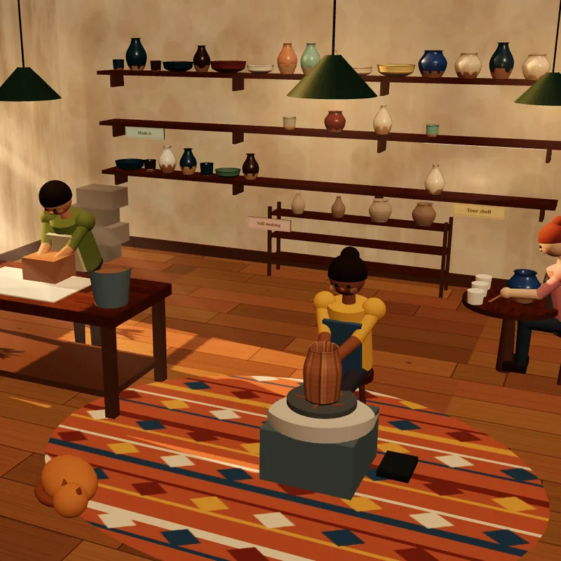 | 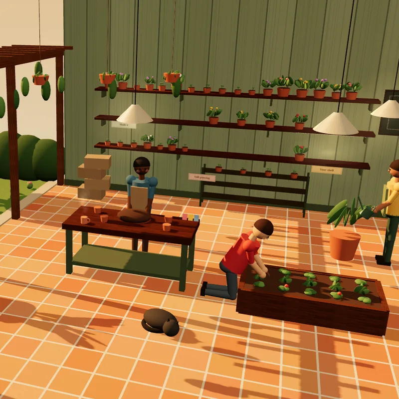 |  | 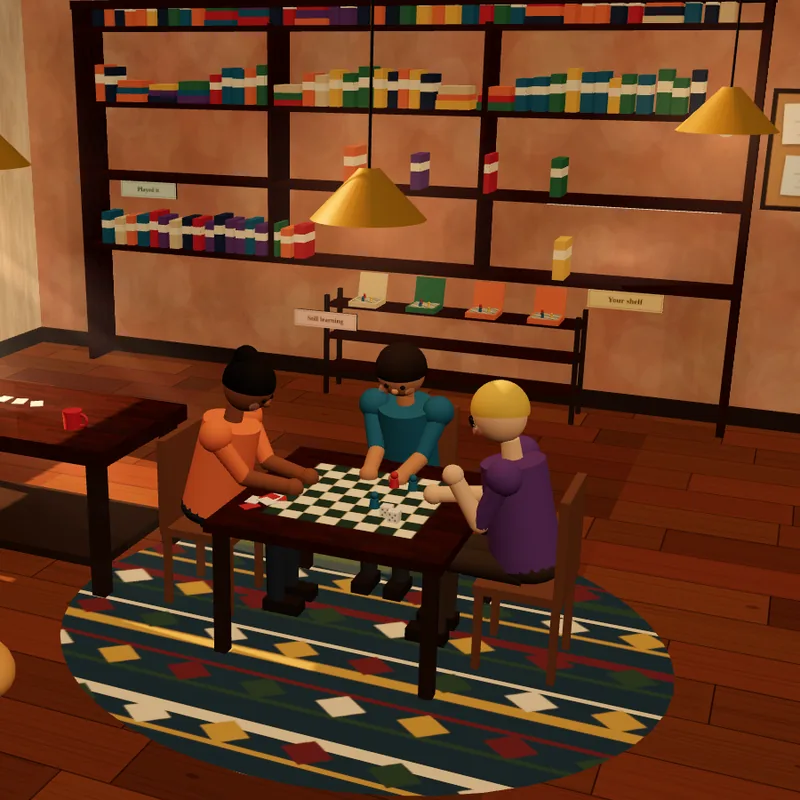 |

## Home

| | Before | After, follows no Corners | After, follows Knitting and Pottery |
|---|---|---|---|
| Phone | 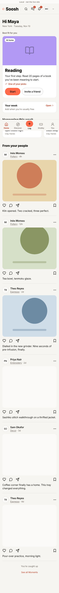 | 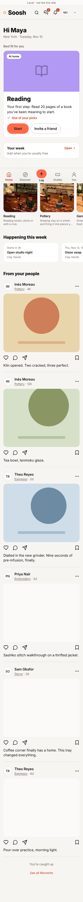 | 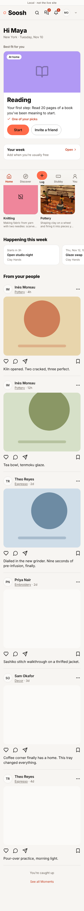 |
| Desktop | 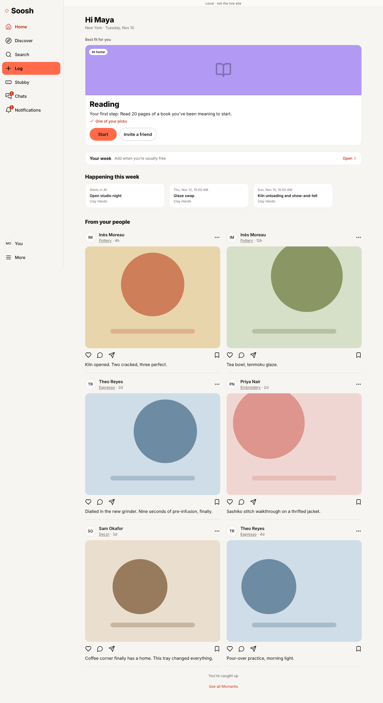 | 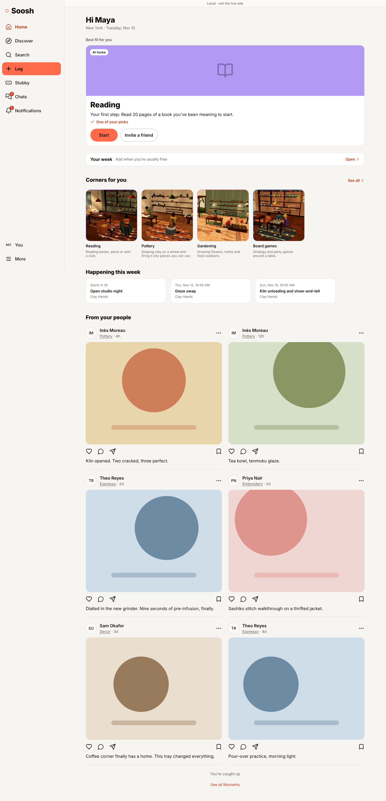 | 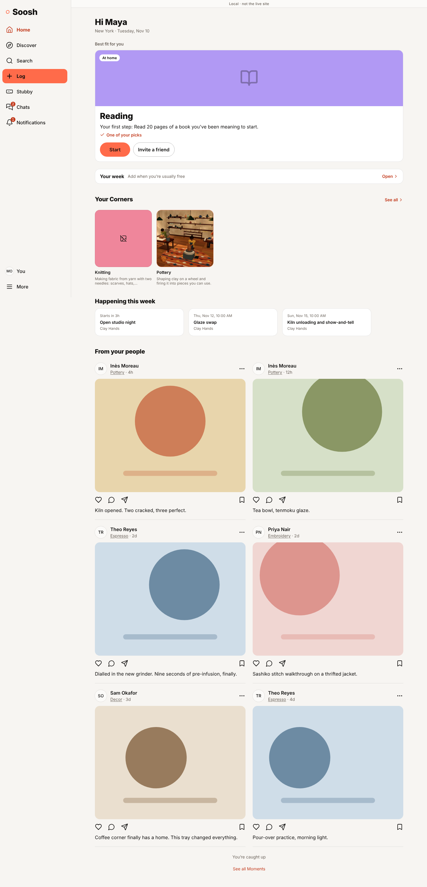 |

## Discover

| | Before | After |
|---|---|---|
| Phone | 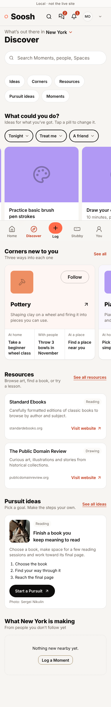 | 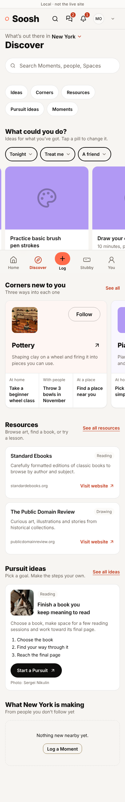 |
| Desktop | 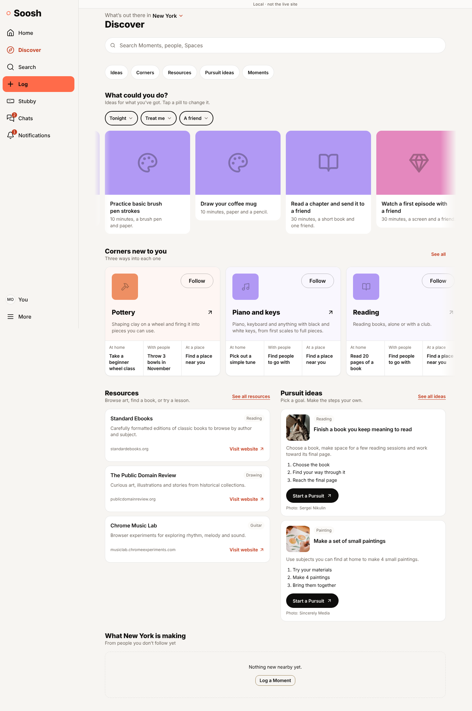 | 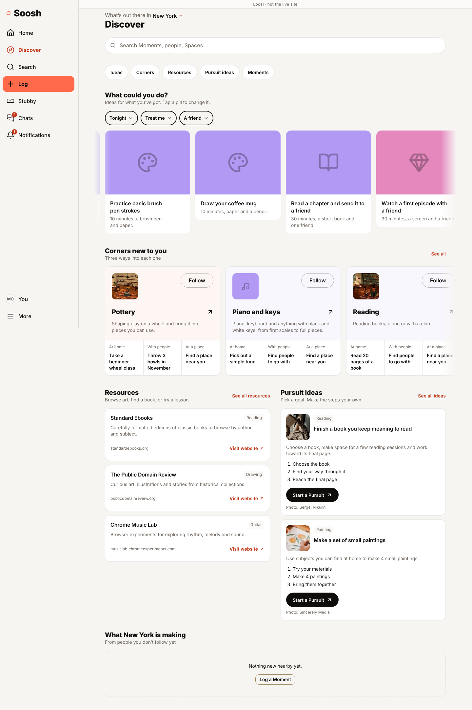 |

## What the run checked

`report.json` lists all 36 checks. In short, on a phone and on a desktop, for someone who follows no Corners
and for someone who follows two:

- Home shows the right heading and Corners, as square, lazy pictures with the Corner name as alt text.
- A card opens the Corner's page.
- On Discover and on `/corners`, only Corners with a 3D world show a still, at the size the tile always was.
- No 3D file (scene, CornerWorld or town) is fetched on Home, Discover or `/corners`.
- Against the build before this change: every heading, link, button, list item and section that was on Home
  (67), Discover (72 on a phone, 80 on a desktop) and `/corners` (635, 652) is the same size and in the same
  place, to within half a pixel. On Home, what sits under the new row is lower by exactly the row's height.
