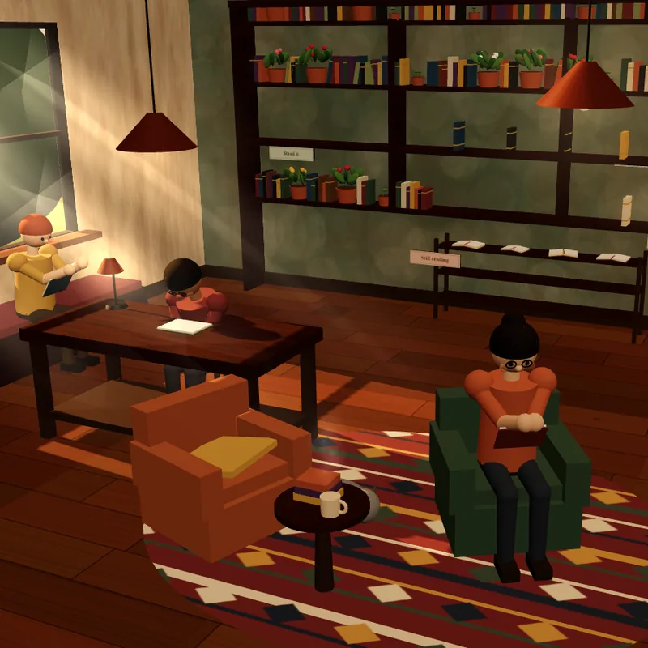
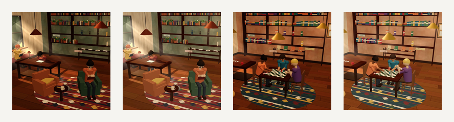
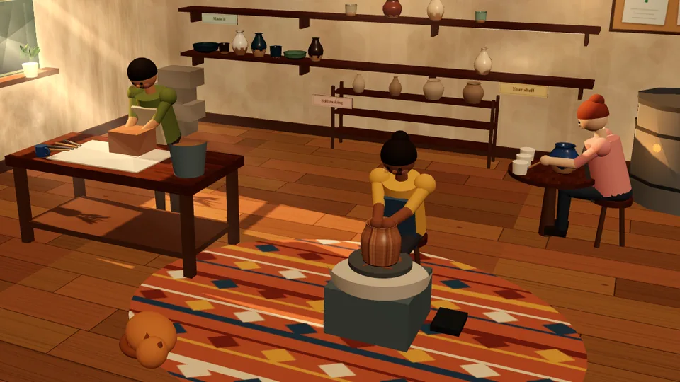
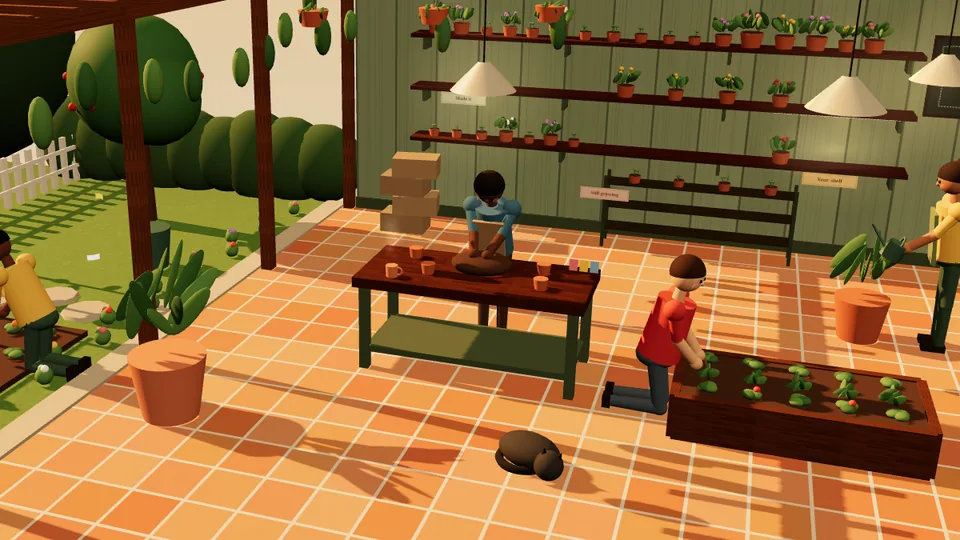
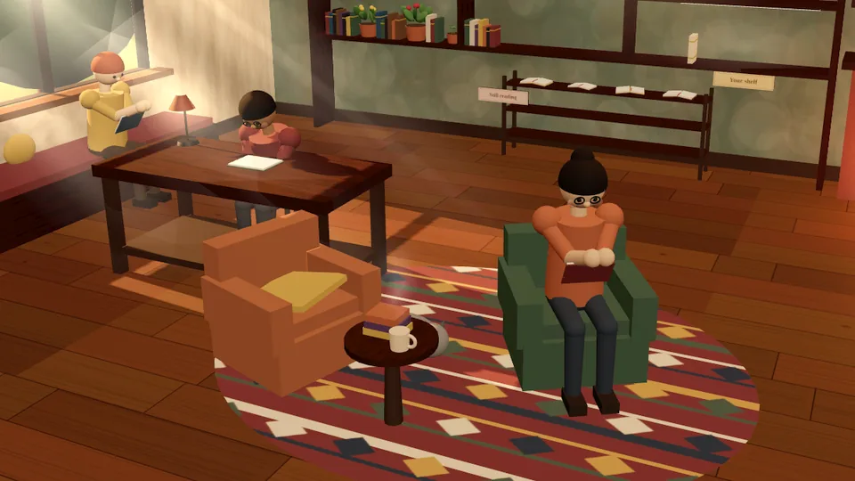
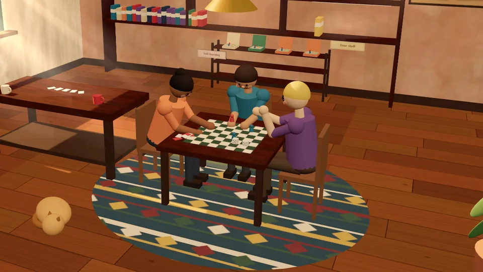
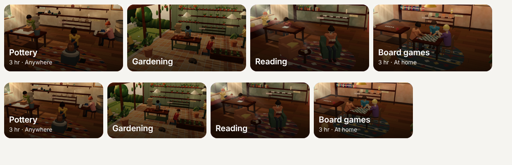
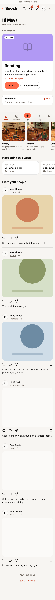
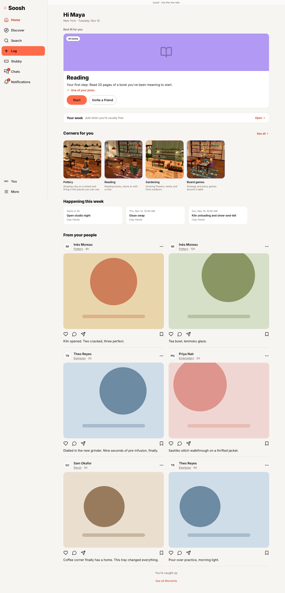

# Corners on Home and Discover

Made by `node scripts/e2e/corners-on-home.ts` on the production build, with the real CSP and fixture data
(no live account or database). Remote photos are blocked in this run, so a Corner without a still shows its
colour tile here; on the live site it shows the photo it has always had.

## The stills

`public/worlds/{slug}/card.webp` (square, 800 by 800) and `card-wide.webp` (16:9, 960 by 540), golden hour,
made by `node scripts/e2e/room-preview.ts --cards`.

Pottery and Gardening were approved on Nov 10, 2026 and are unchanged.

| Pottery (61.6 kB) | Gardening (75.4 kB) |
|---|---|
|  |  |

### Reading and Board games, brightened (for approval)

The same frame and the same cut as before. The shadows are opened (`CARD_LIFT` in the script) and white stays white.

| | Before | After |
|---|---|---|
| Reading (54.0 kB) |  |  |
| Board games (64.1 kB) |  |  |

On the page's own background, at the size Home shows them on a desktop (Reading before, after; Board games before, after):

### The 16:9 stills for the Corner list (for approval)

Cut from the same frames so the characters stay in frame on a wide card. Reading and Board games are brightened the same way.

| Pottery (53.6 kB) | Gardening (76.0 kB) |
|---|---|
|  |  |

| Reading (43.4 kB) | Board games (50.5 kB) |
|---|---|
|  |  |

As the cards on `/corners`, on a desktop (top) and on a phone (bottom):

## Home

Everyone sees the Corners with a 3D world, under "Corners for you". The ones a person follows come first,
then their picks (founder, Nov 10, 2026).

| | Before | After, follows no Corners (Reading is a pick) | After, follows Knitting and Pottery |
|---|---|---|---|
| Phone |  |  |  |
| Desktop |  |  |  |

## Discover

| | Before | After |
|---|---|---|
| Phone |  |  |
| Desktop |  |  |

## What the run checked

`report.json` lists all 36 checks. In short, on a phone and on a desktop, for someone who follows no Corners
and for someone who follows two:

- Home shows "Corners for you" with the four 3D Corners in the right order (followed first, then picks), as square, lazy still pictures with the Corner name as alt text. A followed Corner without a 3D world, and a followed Space, are not in the row.
- A card opens the Corner's page.
- On Discover and on `/corners`, only Corners with a 3D world show a still, at the size the tile always was. The cards on `/corners` use the 16:9 still.
- No 3D file (scene, CornerWorld or town) is fetched on Home, Discover or `/corners`.
- Against the build before this change: every heading, link, button, list item and section that was on Home
  (67), Discover (72 on a phone, 80 on a desktop) and `/corners` (635, 652) is the same size and in the same
  place, to within half a pixel. On Home, what sits under the new row is lower by exactly the row's height.
