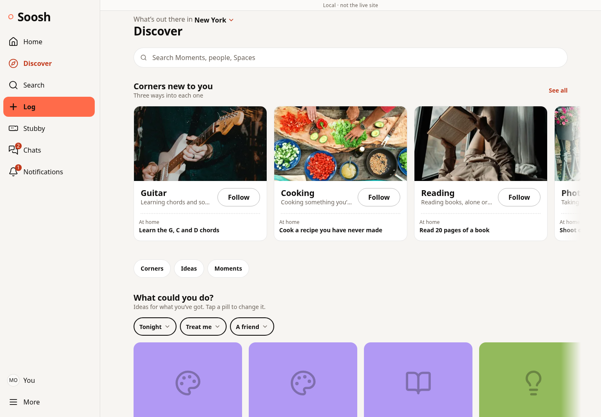
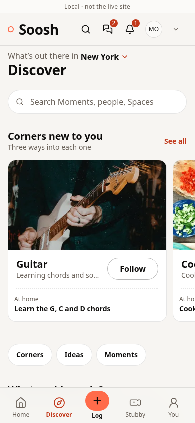

# Discover Corner carousel

Built on `feature/discover-corner-carousel` from main `d06c795`, which includes
the merged landing revision (PR 331). This is a separate application change.

## What changed

- The existing Corner section is directly below search. Large landscape photos,
  names and a partially visible next card make the row clear on phones and desktop.
- Signed-in users see up to 12 server-ranked Corners rather than a three-card
  grid. The request is bounded at 16, with replacements available after following.
  Server eligibility and the existing age-safe candidate list remain unchanged.
- Visitors keep the diverse public selection and read-only signup gates.
- “See all” opens the existing Corner directory. It stays available during loading
  and when a recommendation read returns empty or fails. Existing follow actions
  and At home / With people / At a place destinations are preserved.
- The existing shared carousel supports touch/trackpads, desktop arrows, mouse
  dragging and keyboard navigation. Arrow tracking now works without visible
  dots; Home/End are available. No autoplay or new dependency is added.
- Back restores the row’s saved position when its contents are unchanged.
  Account changes clear the prior account’s Corner cards, hidden choices and
  cached tab names. No private goals are moved into public fields.
- Five exact-activity photos supplied for the landing are reused locally for
  Guitar, Cooking, Reading, Photography and Painting. Other Corners keep their
  existing photos and category-icon fallback. Home’s photo callers are unchanged.
- The browser check is available as `npm run e2e:discover` and runs in CI.

## Evidence

- Full suite: 247 files, 2,341 tests passed. Focused Discover/carousel/image
  regression tests: 27 passed. TypeScript and token lint passed.
- Production build passed, with the existing approximately 3.45 MB bundle warning.
  Migration ordering (233 files) and tracked-build-output checks passed.
- Chromium with the real CSP at 320, 390, 768 and 1440 px, including dark mode:
  the Corner row appears above Ideas and within the initial viewport, twelve
  cards remain available, all five local photographs decode, the page does not
  overflow horizontally, and measured visible text contrast passes.
- Actual keyboard arrows/Home/End, physical touch dispatch and desktop arrows
  move the row. Normal-motion desktop photo dragging moves the row without
  opening a Corner; native image dragging is suppressed inside the carousel.
  Real Corner/directory navigation and Back restoration pass.
  Guests can browse; following opens signup without a follow write. A 503
  recommendation read still leaves the directory usable.
- Unit regressions verify section order, more than three ranked cards, existing
  action positions, directory access during loading, stale-account cleanup and
  repeated keyboard navigation when the optional dot pager is absent.

[Browser report](browser-report.json) contains the checks. Screenshots show
actual local production UI with fixture services, not a live member session.
The fixture ranking deliberately includes the five locally photographed Corners.
It is not evidence that every account receives those same recommendations.





## Reproduce

```sh
npm test -- --maxWorkers=4
npx tsc --noEmit
npm run lint
node scripts/check-migrations.ts origin/main
bash scripts/check-no-build-output.sh
PLAYWRIGHT_CHROMIUM=/usr/bin/chromium npm run e2e:discover -- --out /tmp/discover-corners
```

The browser command builds into a temporary directory unless `--dist` is given.
Omit `PLAYWRIGHT_CHROMIUM` for a Playwright-managed Chromium installation.

## Compatibility, limits and rollback

No database migration, RLS/access policy, provider, quota, age/care check, private
preference meaning or production flag changed. No recommendation constraint is
relaxed and no live user data was read. Existing follow and signup actions remain.

Remote media and external fonts are blocked in this environment. Captures show
the real local photos plus honest category-icon fallbacks for other activities,
using system font fallbacks. They do not substitute synthetic stock photographs.
Real-iPhone/WebKit, external photo loading and live-service checks remain release
checks. No merge or production deployment was performed.

Rollback is a frontend revert and rebuild. There is no data rollback.
