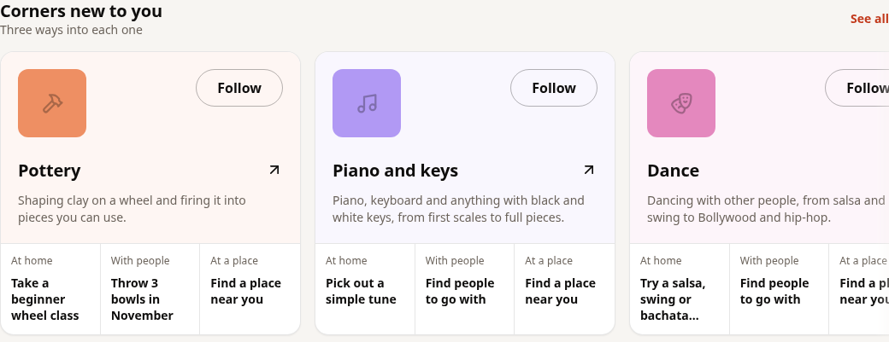
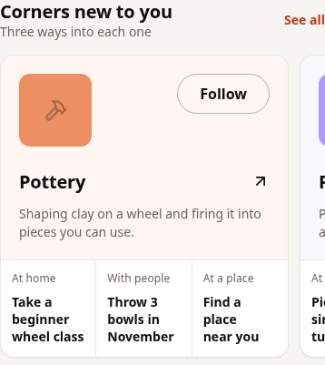

# Corner card polish

The owner approved taking the carousel live and requested more attractive
Corner cards. This revision changes only the Corner card component and its
regression coverage. The existing carousel remains in its original section.

## Card changes

- Larger 80 px thumbnails from the existing photo source, with the same fallback.
- Full Corner names, an arrow indicating the existing destination, and a
  two-line description instead of squeezed single-line copy.
- A subtle existing Corner colour in the header, a clean border and shadow.
- Follow stays prominent, with its existing action. The activity tabs retain
  their labels and targets, with cleaner separators and aligned footers.

No replacement photo mapping, new copy, recommendation change or new package.
Search, Ideas, jump chips, People and Moments components/styles are unchanged.
The same six-result request and three-card display remain. The card height
changes the vertical flow of the sections below it.

## Validation

- Full suite: 246 files, 2,337 tests passed. Focused Discover regression: 21 passed.
- TypeScript, token lint, production build, migration ordering (233 files) and
  tracked-build-output checks passed. The existing Vite large-bundle warning remains.
- Production Chromium with real CSP at 320, 390, 768 and 1440 px, including dark
  mode: no page overflow, visible text contrast, native keyboard scrolling,
  physical touch swipes or desktop arrows, Corner/directory navigation and
  Back restoration. The test waits for the destination to finish rendering
  before Back to avoid a transient SPA-navigation race.
- The browser fixture includes People and Moments, and asserts they render.
  It uses sample data; remote photos/fonts are blocked here and use existing
  fallbacks. No claim of a live account or remote-photo validation.

[Browser report](browser-report.json) and [full desktop view](desktop-full.png).





## Release status

Pushed to the existing `feature/discover-corner-carousel` branch. The owner
authorized publication. This session cannot publish: GitHub's GraphQL API
returns Forbidden, no Vercel CLI/deploy credential is configured, and the declared
network policy does not include the live domain. Git HTTPS
fetch/push works. No merge or deployment is claimed.

The documented release flow is in `docs/deploys.md`. Staging is currently
130 commits behind main and has one unique merge commit; synchronizing release
branches is a release operation, not part of this card design change. No branch
was force-pushed, merged or deployed. A current-main review contains only this
Corner carousel and its polish plus tests/evidence.

Rollback is a frontend revert and rebuild. No migration or data rollback.

## Reproduce

```sh
npm test -- --maxWorkers=4
npx tsc --noEmit
npm run lint
PLAYWRIGHT_CHROMIUM=/usr/bin/chromium node scripts/e2e/discover-corners.ts --out /tmp/discover-corner-polish
```
