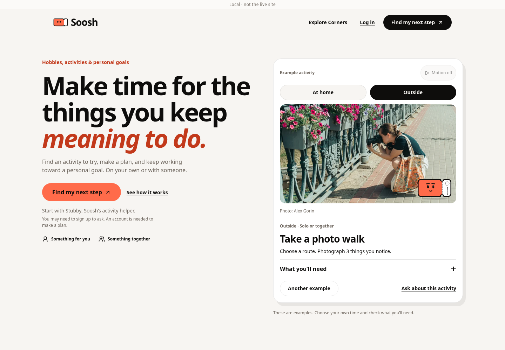
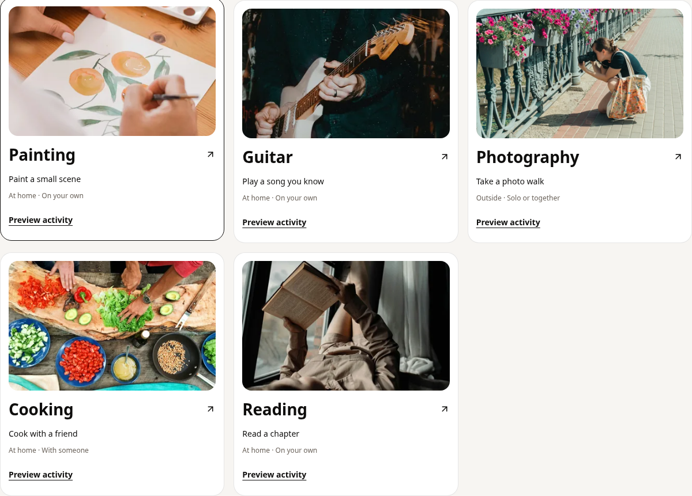
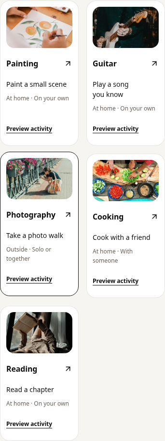

# Uploaded landing photos and Motion

Historical evidence for the uploaded-photo revision. The subsequent owner-requested
simplification removes the hero pause/setting controls and adds visual Stubs.
See [the current revision](../landing-streamlined/README.md) for its results.

Follow-up to landing v3 on `feature/landing-purpose-and-pursuits`. The owner
provided six original photographs in `Archive.zip` and requested Framer Motion.
No application data, recommendation provider, production flag, quota or access
rule changed. Nothing was merged or deployed.

## Result

- All six uploaded photos are optimized and served locally, with subject-aware
  crops and 400/800/1600 px WebP variants. All variants together are 1,610,190 bytes;
  original JPEGs are retained outside Git. EXIF is absent from the shipped files.
- The initial photo shows a person photographing flowers. The watercolor photo
  belongs to Painting; the two Reading photos serve home/outside examples. The
  all-interests gallery shows each Corner once. No unrelated photo is used to
  fill a card or substitute for an old request.
- Credits/source ids come from the original filenames, recorded alongside
  hashes, dimensions and crops in `public/landing/photos/uploaded-photos.json`.
  This is owner-supplied photography, not a claim of an independent stock-photo
  search, source-page verification, real Soosh members or available venues.
- The existing Motion dependency powers photo and goal-preview transitions.
  React's reduced-motion preference and the existing pause control govern them.
  The native engine cancels immediately and restores visible content on cleanup.
  Controls stay outside the moving content. No new animation package or plugin
  installation is needed.
- Existing pointer tilt, tappable Stubby and horizontal swiping remain. Native
  controls preserve keyboard use and vertical touch scrolling.
- `ImageWithFallback` accepts optional explicit responsive sources. If a candidate
  fails, it retries the base source without `srcSet`, then shows the local graphic
  on total failure. Existing callers without explicit variants keep their behavior.
- Existing Drawing/Birdwatching ids are retained for old editable request drafts;
  new Painting/outdoor Reading ids are allowlisted explicitly. Exploring examples
  never writes an answer, creates a plan or submits an ask automatically.

## Evidence

- Full suite: 245 files, 2,337 tests passed. Focused landing, image fallback and
  metadata checks: 37 passed. TypeScript, token lint and production build passed.
  The pre-existing Vite large-bundle warning remains.
- [Default flag](browser-report.json) and
  [human onboarding](browser-report-human.json) production-build browser runs
  passed at 320, 390, 768 and 1440 px, plus normal-motion desktop and touch cases.
  The actual local images were decoded; gallery `currentSrc` selected a shipped
  variant and requested no external photo. The outdoor Reading image was checked
  separately after switching examples, covering all six uploads.
- Browser checks recorded intermediate goal-transition opacity frames, verified
  fully visible content and stopped animation on pause, and kept reduced-motion
  cases static. High-density missing-photo responses exercised real browser
  recovery and confirmed no misleading photographer credit remained.
- Existing coverage also checks Corner filters/links, actual Pursuit signup
  navigation with its selected title, editable request handoff, guest gates,
  failure/retry and no automatic account/preference/ask writes from the landing.
- The short [interaction recording](interaction-demo.mp4) shows the actual local
  production build with real photos and movement. Supabase/provider responses are
  mocked; it is not a live production or live-user recording.

The images themselves were visually reviewed, along with desktop/mobile crops.
The old image-host blocker is resolved for landing delivery because the photos
are local. Public source links remain available for attribution, not image loading.

External fonts were blocked during capture, so screenshots use system fallbacks.
WebKit/real-iPhone and live OAuth/provider checks remain separate release checks.
No live database, account signup, invitation delivery or conversion lift is claimed.







Gallery captures temporarily hide the sticky navigation and skip control to
capture the complete section. The production layout is unchanged by that capture.

## Reproduce

```sh
node scripts/landing-photos.mjs /path/to/extracted-originals
npm test -- --maxWorkers=4
npx tsc --noEmit
npm run lint
npm run build
PLAYWRIGHT_CHROMIUM=/usr/bin/chromium npm run e2e:landing -- --record
PLAYWRIGHT_CHROMIUM=/usr/bin/chromium npm run e2e:landing -- --human
```

Omit `PLAYWRIGHT_CHROMIUM` for a Playwright-managed installation. Recording also
requires Playwright's FFmpeg. The local recording used system FFmpeg through a
temporary cache outside Git; no browser or encoder binary is committed.

Rollback is a frontend revert and rebuild. No data rollback or migration is needed.
