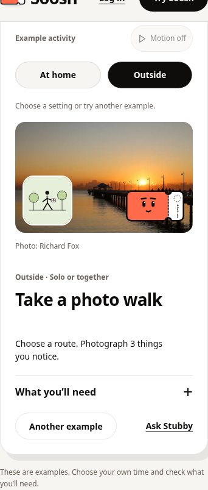
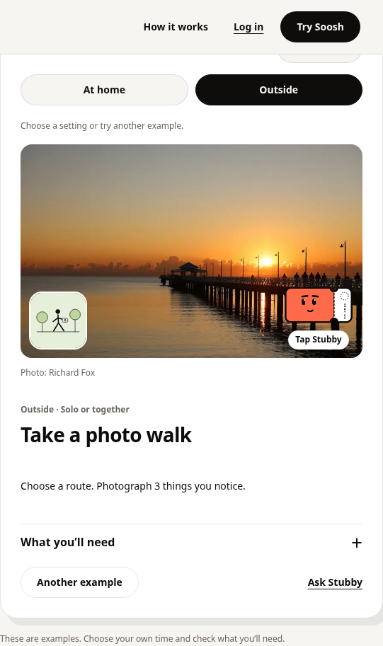

# Landing photos and visible motion

Follow-up to merged PR #324. Removes the local-suggestions FAQ from the page,
crawler copy and FAQ structured data. Keeps Soosh as the product and Stubby as
the helper, with the existing request, account and feature-flag behavior.

## What changes

- Photo-backed hero and gallery cards reuse the app's activity photo library.
  The photo-walk example reuses the correctly credited local pier photograph.
  Images have descriptive alternatives, fixed aspect ratios, eager hero loading,
  lazy gallery loading and local illustration fallbacks.
- Small activity graphics trace a sketch, move a pencil, strum strings, step,
  rise as steam or move a bird. Decorative loops stop outside the preview.
- Stubby reacts to a native play button, with a visible Tap Stubby instruction.
  The artwork floats inside a steady click target; the button itself does not
  float away from the pointer. Tapping it does not make a plan or use an ask.
- The photo tilts gently with a mouse. Tilt resets over controls and on pointer
  exit. Touch users can swipe horizontally between examples; vertical scrolling
  and the equivalent native buttons remain available.
- Pause motion stops graphics, photo transitions, tilt and Stubby's Web
  Animations. Play motion resumes them. The device's reduced-motion preference
  keeps motion off. Pause is local to the page and saves no personal information.
- A backward-compatible `motionEnabled` prop on Stubby supports the local pause
  control. Its default is true; other app screens keep their existing behavior.

There are no migrations, new secrets, new photo ids, recommendation-provider
changes or changes to production flags. Example choices remain editable drafts
only when someone explicitly opens Stubby. Guest/signup continuity, care, age,
access checks, quotas and owner-only data remain unchanged.

## Evidence

[Watch the 12-second browser recording](interaction-demo.mp4). It shows the
actual application, including the photo, character reaction, pause/resume and
pointer movement. It is a local fixture build, not a production recording.

- Full current suite: 231 files, 2,215 tests passed. Final focused regression
  checks: 56 tests passed. TypeScript, token lint and production builds passed.
  Vite retains the existing large-bundle warning.
- Both [normal-flag](browser-report.json) and
  [human-onboarding](browser-report-human.json) production-build browser checks
  passed. They cover 320, 390, 768 and 1440 px with reduced motion, light/dark
  themes, keyboard/touch controls, text contrast and 44 px targets. Additional
  desktop/touch cases check motion at 1280/390 px, a rendered character reaction,
  actual pause/resume, pointer tilt, horizontal swiping and normal vertical
  scrolling. Trying examples creates no account, preference write or ask.
- The actual local photo is fetched and its decoded dimensions are checked.
  Remote image failures render the local activity graphic. The removed question
  is absent from the DOM and the crawler/structured copy.
- Existing guest end-to-end checks passed: guest limits, signup/same-chat return,
  draft replay, memory, feedback, onboarding Back/resume and resource/cost ranking.

Services are mocked. No live provider, OAuth or hosted database validation is
claimed. This cloud blocks `images.unsplash.com`; the 5 external library photos
could not be downloaded or visually reviewed here. Tests deliberately exercise
that failure path and never replace those photos with unrelated fixtures. Check
all photo sources on a connected preview before release. External font requests
were also blocked, so the screenshots use system fallbacks. WebKit was unavailable
locally; its existing CI job remains enabled.





## Reproduce and rollback

```sh
npm test -- --maxWorkers=4
npx tsc --noEmit
npm run lint
npm run build
# Installing Playwright Chromium also installs the FFmpeg needed for recordings.
npx playwright-core install chromium
npm run e2e:landing -- --record
npm run e2e:guest
npm run e2e:landing -- --dist dist-e2e --human
```

The local run used system Chromium and system FFmpeg through a temporary browser
cache outside the repository. No browser binary or generated build is committed.
CI records the normal-flag motion run and uploads both flag variants' evidence.

Rollback is a frontend revert and rebuild. No database or provider rollback is
needed. Existing plans, answers and feedback are untouched. This work does not
merge or deploy production.
