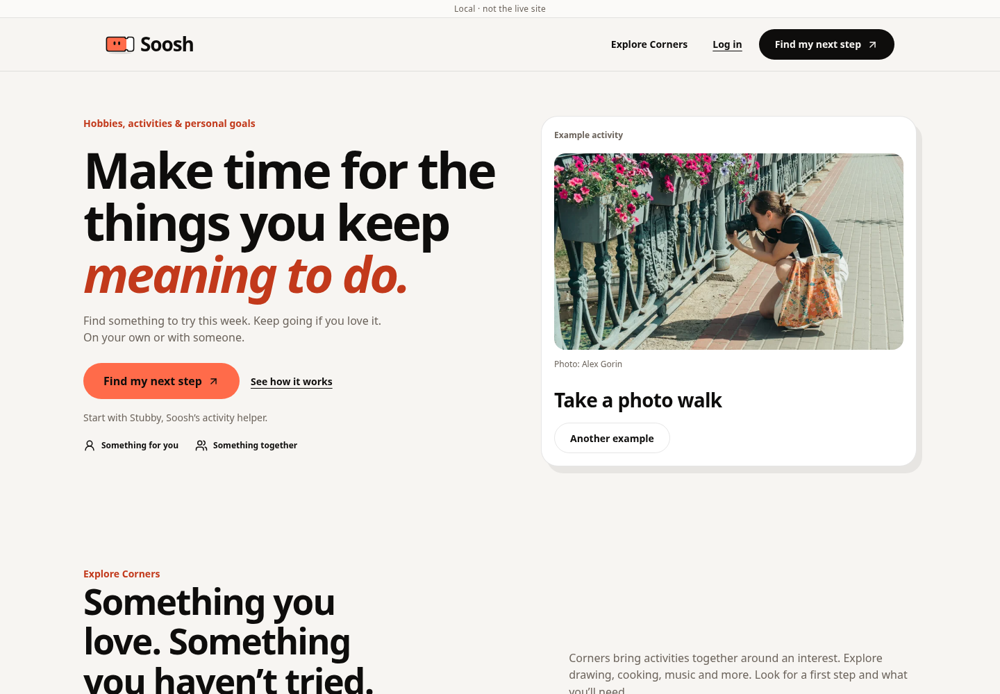
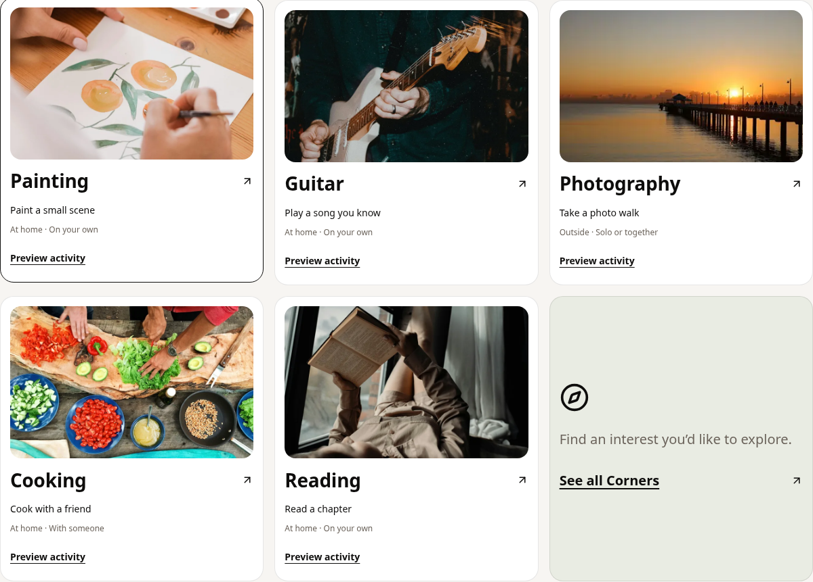
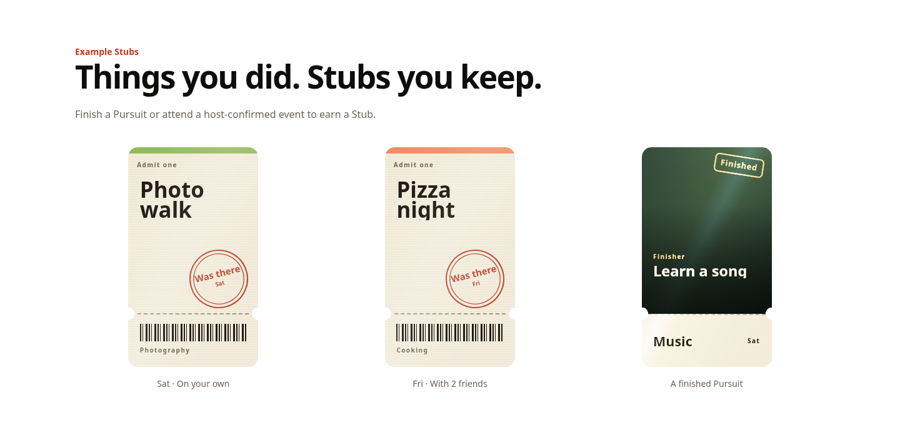
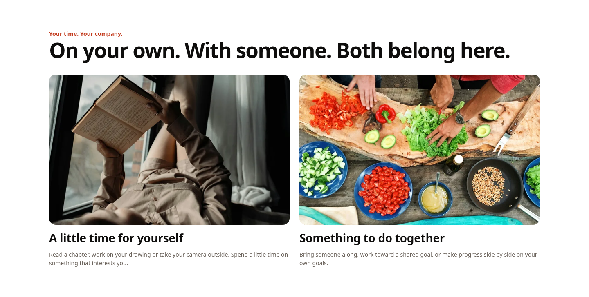

# Streamlined landing page

Owner-requested follow-up on `feature/landing-purpose-and-pursuits`, Nov 5, 2026.
This supersedes the hero controls and copy in the earlier local-photo report.
The NYC weekend strip is intentionally omitted at the owner’s request.

## Changes

- New hero invitation: “Find something to try this week. Keep going if you love
  it. On your own or with someone.” The five repeated disclaimer lines are gone;
  account, cost and booking information remains in the FAQ.
- Step 2 says “Grab the Stub” and “Pick a time, bring someone if you like.”
  Spaces have the requested one-line explanation.
- The hero keeps the photo, title, successful-photo attribution and one
  “Another example” button. Setting, requirements and pause/play controls are
  removed. No ongoing animation remains: swaps are short and user initiated.
  Pointer tilt and horizontal touch swiping remain optional shortcuts.
- The default grid has six cards, including a working “See all Corners” link.
  The Photography card uses the existing local sunset-pier image, distinct from
  the owner-uploaded hero photo. Filters retain distinct Corners.
- Three labeled example Stubs reuse the real `StubArt` component, with a
  horizontally scrollable, keyboard-focusable row on phones and three columns
  on desktop. Their explanatory line describes existing earning rules rather
  than promising a Stub for every activity. No issuance logic changes.
- Reading and cooking photographs give equal visual weight to solo and shared
  use. Larger responsive size hints keep these photos sharp on desktop.
- The page follows reduced-motion changes during a visit. Browser testing found
  that the dependency’s hook only snapshots the initial preference; a media-query
  subscription now stops Motion transitions and resets pointer tilt immediately.
- Social metadata, JSON-LD, manifest and readable no-JavaScript content match
  the revised wording. No private account data is fetched for examples.

## Validation

- Full suite: 246 files, 2,336 tests passed. Focused landing, image fallback and
  metadata coverage: 36 passed. TypeScript and token lint passed.
  Production builds passed for both onboarding flag configurations; the existing
  approximately 3.45 MB Vite chunk warning remains.
- Migration ordering: 233 files, no problems against `origin/main`. Tracked-build
  output checks and their self-tests passed. No migration or access policy changed.
- Production-build Chromium checks with the real CSP and mocked Supabase passed
  at 320, 390, 768 and 1440 px, including dark mode. They check actual image
  decoding, no page overflow, measured contrast, 44 px controls, filters, focus,
  signup redirects, editable request handoff and no automatic account/ask/writes.
- Normal-motion desktop and physical touch dispatch check actual intermediate
  frames, pointer tilt/swiping and live device-preference changes. Missing
  high-density photo responses recover to an honest local graphic without a
  false photographer credit. Explicit request failure/retry and closed-guest
  gates retain existing behavior.
- New unit coverage verifies live reduced-motion updates and listener cleanup.
  Regression coverage checks the exact copy, six-card grid, distinct photographs
  and actual Stub artwork without reads from anyone’s private Shelf.

See [default browser report](browser-report.json),
[human-onboarding report](browser-report-human.json) and the
[short interaction recording](interaction-demo.mp4). Screenshots were visually
reviewed on desktop and mobile. The recording is of a local production build
with service fixtures; it is not a live production recording.









Section captures temporarily hide the sticky navigation and skip control to
show the complete section. They do not change the production layout. Mobile
Stubs remain horizontally scrollable instead of extending the page height.

## Reproduce

```sh
npm test -- --maxWorkers=4
npx tsc --noEmit
npm run lint
node scripts/check-migrations.ts origin/main
bash scripts/check-no-build-output.sh
PLAYWRIGHT_CHROMIUM=/usr/bin/chromium npm run e2e:landing -- --record
PLAYWRIGHT_CHROMIUM=/usr/bin/chromium npm run e2e:landing -- --human
```

Use Playwright’s installed browser if `PLAYWRIGHT_CHROMIUM` is omitted. Recording
requires its FFmpeg; local evidence used system FFmpeg via a temporary cache
outside Git. Both browser commands build production assets in temporary paths.

## Compatibility and release limits

No provider, quota, care, age/access, owner-only goal, plan action, database or
production flag changes. Guest entry and the selected Pursuit’s title/Corner
continue through existing signup gates. No merge or deployment was performed.

External fonts were blocked during capture; screenshots use system fallbacks.
Real-iPhone/WebKit and live OAuth/provider checks remain release checks. No live
database, invite delivery, conversion lift or available NYC picks are claimed.

Rollback is a frontend revert and rebuild; no data rollback is required.
