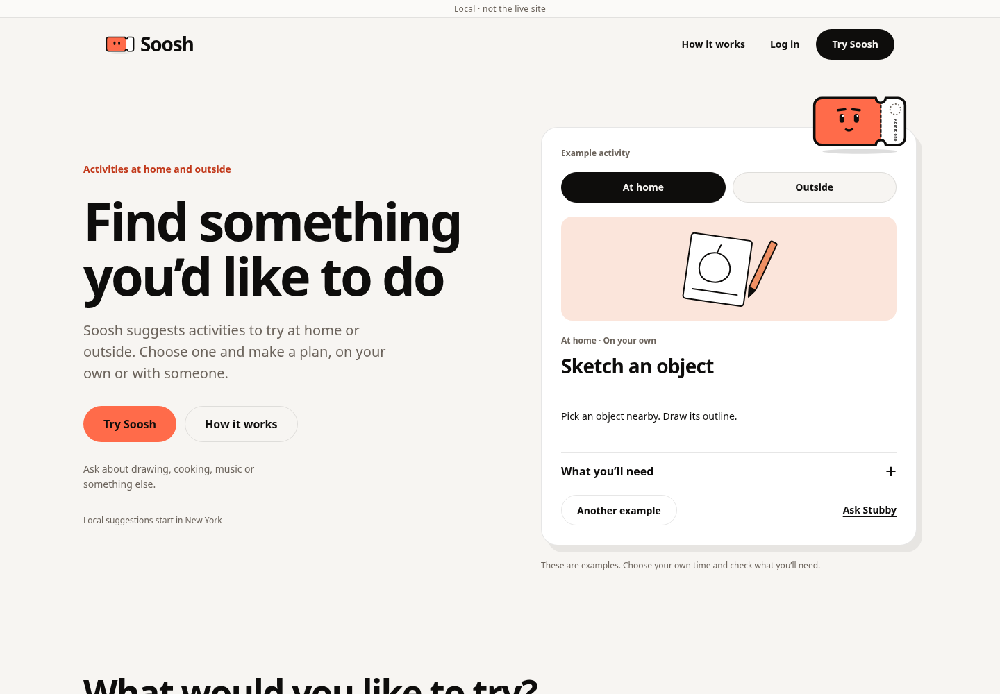
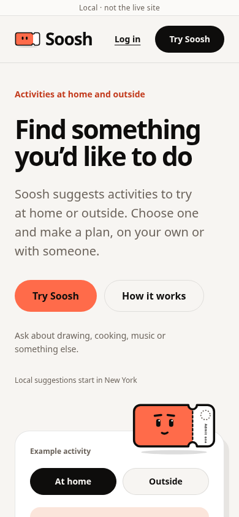
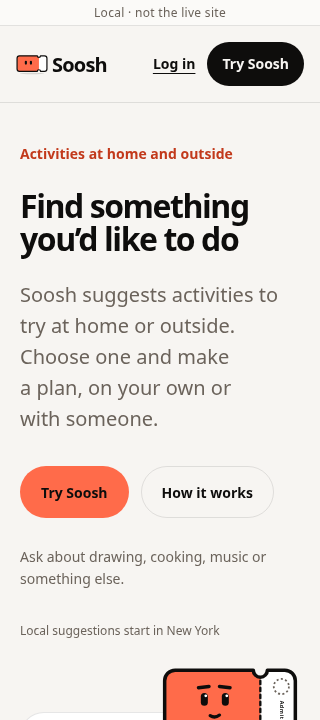
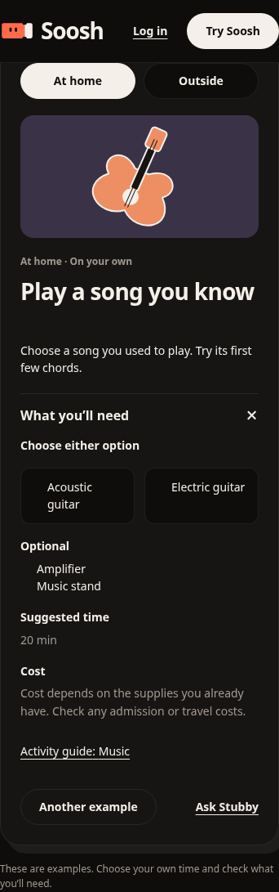

# Interactive landing page

This records the initial PDF v2 implementation and its original browser evidence.
The later photo/motion follow-up adds photographs, stronger visual interactions
and a pause control; its evidence is recorded under `docs/qa/landing-motion/`.

Implements the reviewed PDF v2: plain copy, Soosh as the product and Stubby as its
activity helper. A signed-out visitor can switch At home / Outside, cycle through
6 editorial examples and open their details before entering the actual app.

## Behavior and compatibility

- Examples are labelled and local. Selecting them makes no recommendation call,
  anonymous signup, saved preference, plan or invitation. The public Corners
  bootstrap still performs its existing read-only request.
- Gallery cards open the corresponding preview, expand its details and move
  keyboard focus there. Details use native disclosure controls. Another example
  cycles within the chosen setting. There is no timer or automatic carousel.
- Required bundles, complete alternatives and optional supplies have separate
  meanings. Practice times are suggestions, not verified durations or calendar
  availability. Costs remain unknown; no example claims free admission or pass
  coverage. Every example links to an existing activity guide.
- Try Soosh opens `/calendar`. A chosen example id can prefill the real composer;
  the request stays editable and is never submitted automatically. No raw request
  is accepted from history state. The existing signup-resume draft takes priority.
- Log in explicitly opens `/login?mode=signin`. Closed guest access still shows
  the existing login/signup gate. Quotas, Claude, care handling, age checks,
  member-only actions and owner-only data are unchanged.
- The preference section reuses the actual 3 question titles and is rendered only
  when `VITE_HUMAN_ONBOARDING` is enabled. It links to actual onboarding. There is
  no landing-page mock form, new feature flag or change to existing flag defaults.
- The landing uses Root's main landmark. Its navigation, disclosures and links
  work with touch and keyboard; reduced motion disables the decorative effects.
- Metadata, crawler HTML and FAQ structured data use the revised copy. The app
  icon replaces the old social image carrying the retired headline. Historical
  photos and screenshot tooling remain in the repository but are not rendered.

This change does not broaden the existing at-home recommendation path or enable
V3 for additional accounts. As the FAQ explains, current at-home suggestions use
chosen interests and existing activities. Broader cold-start discovery and parity
of all request constraints remain recommendation work, not a new landing promise.

## Validation

- Full Vitest suite: 230 files, 2,210 tests passed. Obsolete tests of the fake saved
  ticket and unused photographs were replaced with example, entry, fact and
  accessibility regression cases.
- Frontend TypeScript, token lint, production build, whitespace, migration-order
  and tracked-build-output checks passed. No migration or Edge function changed.
  Vite retains its existing large-bundle warning.
- `npm run e2e:landing`: production assets served with `vercel.json` headers,
  including the real CSP, against mocked Supabase. Chromium covered 320, 390, 768
  and 1440 px; light and dark themes; keyboard and touch; no horizontal overflow;
  at least 44 px controls; non-wrapping navigation; WCAG text contrast; expanded
  requirements; reduced motion; FAQ controls; no example side effects; editable
  draft handoff; explicit request failure/retry; existing-account login; and
  closed guest access. Human onboarding off and on were checked separately.
- Existing `npm run e2e:guest` passed: guest limits, signup continuity, blocked ask
  replay, memory editing/deletion, optional temporary feedback, preference
  persistence, Back/resume, summary editing and resource/cost reranking.

The browser services are fixtures. No live Claude search, production signup,
booking, payment, invitation or database migration was performed. External font
requests were blocked; screenshots show the app's system font fallbacks. Real
provider quality, deployed flags, fonts and OAuth still need an owner-controlled
preview smoke test. WebKit was not available in this environment; the existing
CI WebKit job remains in place.

## Evidence and reproduction

[Browser report](browser-report.json) records the normal-flag run. CI repeats the
landing checks with normal flags and the human-onboarding fixture build, then
uploads both reports and screenshots.

```sh
npm test -- --maxWorkers=4
npx tsc --noEmit
npm run lint
npm run build
node scripts/check-migrations.ts origin/main
bash scripts/check-no-build-output.sh
PLAYWRIGHT_CHROMIUM=/usr/bin/chromium npm run e2e:landing
PLAYWRIGHT_CHROMIUM=/usr/bin/chromium npm run e2e:guest
PLAYWRIGHT_CHROMIUM=/usr/bin/chromium npm run e2e:landing -- --dist dist-e2e --human
```









## Rollback

Revert the landing implementation commits and rebuild the frontend. There are
no database, secret or provider changes to undo. Old clients ignore the optional
example id in router state. Existing private answers, plans and feedback remain
untouched. Nothing in this work merges or deploys the change to production.
