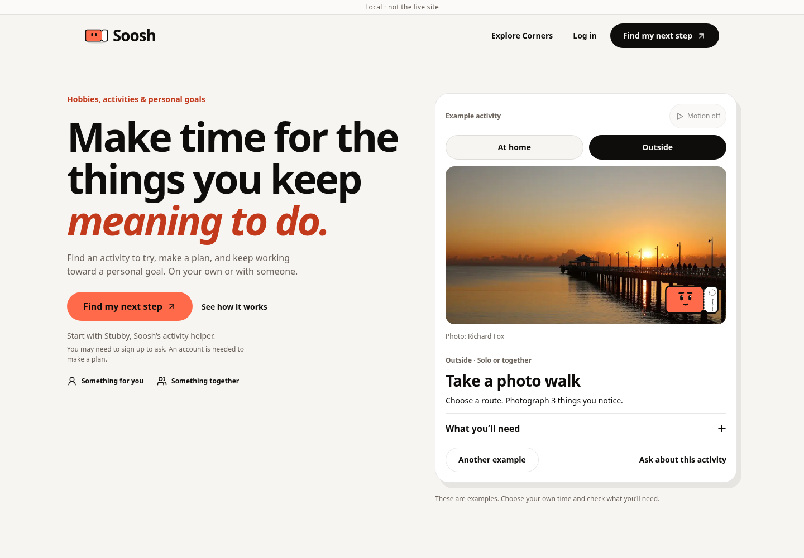
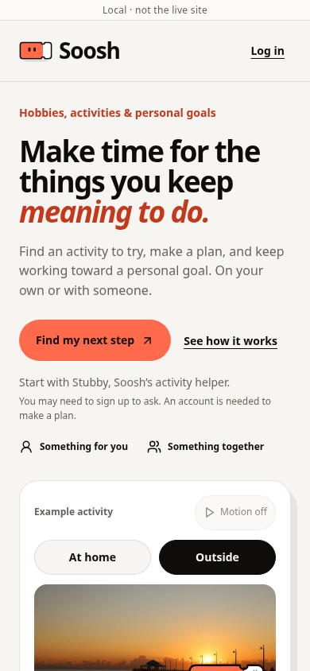

# Landing page v3 implementation

This records the initial v3 implementation. The photo-host blocker below has
been resolved by the owner-uploaded local photography and Motion follow-up:
[current evidence](../landing-local-photos/README.md). Historical test results
and screenshots below are retained rather than relabeled as a later run.

Implements the reviewed landing design after the owner asked to return to the
landing page and build it. Built on main `d9477bb`, preserving the newer Pursuit
and Calendar changes and carrying forward the existing photo/motion work.
The uploaded v3 PDF matches the reviewed design artifact. The 3D-world discussion
is a separate concept and is not advertised or implemented here.

## Behavior

- Emotional headline plus literal hobby, activity and personal-goal description.
  Soosh is the product; Stubby is its helper. The main entry remains the real
  calendar/Stubby route, with an honest signup disclosure and existing gates.
- Public Corners use the existing Corner paths. Local filters change the actual
  representative cards, without saving preferences. Preview activity opens that
  example's requirements; Ask about this activity carries only an allowlisted
  example into an editable request. Nothing sends automatically.
- Pursuit examples switch locally. Start a Pursuit goes through actual onboarding
  with the selected title and Corner in the redirect to `/pursuits/new`. The
  current creation flow remains in charge of tracking choices, invitations and
  saving. Illustrative completion is never transferred into real progress.
- Solo and shared uses have equal emphasis. Supporting content explains Moments,
  Shelf, Stubs and Spaces. No fixed catalog count, geographic availability,
  AI-world, App Store, free-admission or automatic-booking claim is made.
- Real activity photography uses the existing photo library. The initial example
  uses the actual local pier photo, not a generated photograph. Small illustration
  overlays were removed so photography remains clear. A failed photo retains the
  existing local activity graphic. Source credit is shown only after a photo
  loads successfully, so a fallback illustration is not attributed as a photo.
- Keyboard controls, native expanders, horizontal touch swiping with vertical
  scrolling, pointer tilt and tappable Stubby remain. Pause motion and the
  device's reduced-motion setting stop decorative movement. Mobile header keeps
  login and places the main action in the hero.
- Title, descriptions, social metadata, structured data, manifest and public HTML
  fallback describe the same product. Removed geographic claims from JSON-LD too.
  Public fallback content is readable without JavaScript; React replaces it.
- Coarse CTA events use existing GA and browser privacy controls. They contain
  action, placement and an optional selected-example boolean, never an interest,
  goal title, raw request, account identifier or email. Existing analytics events
  alone are not a claim of end-to-end conversion attribution or improvement.

## Compatibility and scope

No migration, database write path, provider, secret or production flag was changed.
Existing Claude integration, care handling, quotas, age/access enforcement,
owner-only information, onboarding continuity and plan actions are preserved.
The newer Pursuit/session migrations already on main have their own release
requirements; this frontend does not apply them. Human preference content remains
conditional on its existing flag. No private progress is read into the landing.

Public crawlable guide URLs, a router migration, automatic Pursuit-based ranking,
new in-product goal nudges and native-app packaging are separate work. This PR
does not imply those proposed future features are already available.

## Validation

- Full suite: 243 files, 2,331 tests passed. Focused landing, copy, metadata and
  analytics regression checks: 43 passed.
- TypeScript, design-token lint and production build passed. The existing Vite
  warning about the approximately 3.45 MB JavaScript chunk remains.
- Both [default](browser-report.json) and
  [human-onboarding](browser-report-human.json) production-build browser runs
  passed: 320, 390, 768 and 1440 px, light/dark, keyboard/touch, contrast for the
  measured text, 44 px controls and no horizontal overflow. Additional desktop
  and touch cases cover movement, character reaction, pause/resume and swiping.
- Browser checks exercise real Corner destinations in links, real Pursuit signup
  navigation and redirect preservation, example-to-request handoff, no automatic
  asks/writes, failed request/retry and both open/closed guest gates. Supabase and
  provider responses are mocked; these are not live account/provider tests.
- Existing guest end-to-end checks passed, including signup/same-chat continuity,
  memory editing/deletion, temporary feedback, human onboarding Back/resume,
  failed preference reads and cost/equipment reranking.
- Migration ordering: 233 files, no problems against main. No tracked build
  output and no whitespace errors.

## Images and remaining release checks

The photo host `images.unsplash.com` returned proxy `403 Forbidden`. The local
hero photo was loaded and its decoded dimensions verified. Five external library
photos remain unverified for content, crop, attribution and availability in this
environment. Browser tests intentionally abort those requests and verify their
failure path; they do not substitute fake photo fixtures and call them real.
External fonts were also blocked; screenshots use system fallbacks.

Before releasing, visually approve all external photographs on a connected
preview, or supply licensed replacements to host locally with recorded credits.
Check real fonts and iPhone/WebKit behavior, and verify live signup, request and
hosted feature availability. No live provider, OAuth, production account, app
deployment or conversion improvement is claimed. A public release should not
treat the external-photo review as completed.





## Reproduce and rollback

```sh
npm test -- --maxWorkers=4
npx tsc --noEmit
npm run lint
npm run build
node scripts/check-migrations.ts origin/main
bash scripts/check-no-build-output.sh
PLAYWRIGHT_CHROMIUM=/usr/bin/chromium npm run e2e:landing
PLAYWRIGHT_CHROMIUM=/usr/bin/chromium npm run e2e:guest
PLAYWRIGHT_CHROMIUM=/usr/bin/chromium npm run e2e:landing -- --dist dist-e2e --human
```

For Playwright-managed Chromium, omit `PLAYWRIGHT_CHROMIUM`. The second landing
run reuses the human-onboarding build produced by the guest test.

Rollback is a frontend revert and rebuild. Existing data needs no rollback.
Do not merge or deploy production as part of this implementation task.
