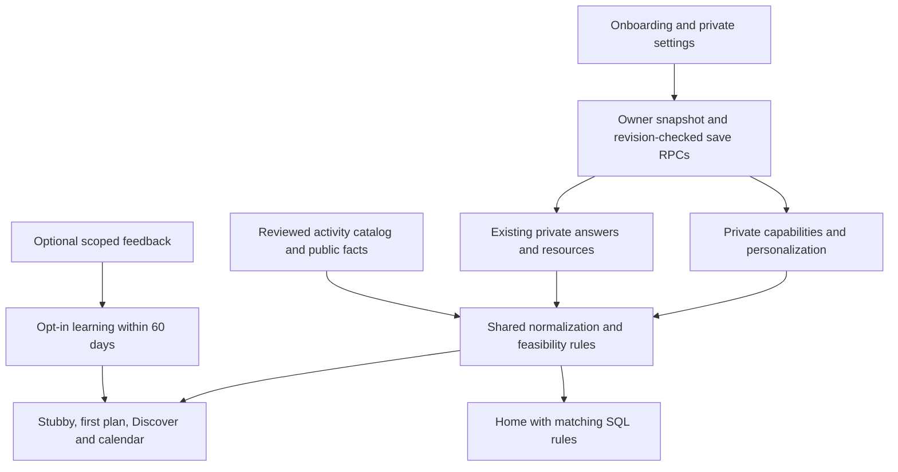

# Clean personalization implementation

This implements the six stages in [the build brief](../briefs/codex-build-clean-personalization.md). The implementation branch is `feature/clean-personalization`, rebased onto main `efb6284`, including its verified care resources and mobile Stubby navigation. Nothing in this branch has been deployed or merged.

## Application behavior

The human flow asks, in order:

1. What would you like to make more room for?
2. What do you already love, or keep meaning to try?
3. What does a little free time look like for you?

One interest is enough. Exploration and Skip are available. Relationships distinguish enjoyment, curiosity and returning to something; beginner suitability influences ranking. The summary reads saved answers, offers editing, and restores them on reload and Back. Practical money, resource, timezone and area questions follow an actual suggestion. Photos and invitations follow suggestions. Invite redirects remain separate from the person's own interests.

`VITE_HUMAN_ONBOARDING=true` enables the new flow and editors. It defaults off until the additive database APIs and compatible readers have been validated and deployed. Existing account, birthdate, membership, guest conversion, RSVP, join and plan creation paths remain. Existing global V3 and per-account shadow/tester controls from main remain; this branch does not change their activation or Claude bindings.

## Data and architecture



| Storage | Meaning and compatibility |
| --- | --- |
| `stubby_capabilities.profile` | Existing V1 capability JSON: timezone, explicit activity budget, resources, private goals/preferences, memberships and feedback consent. Its shape/version stays compatible. |
| `stubby_capabilities.personalization` | Separate additive JSON: motivations, interest relationship/experience, rhythm, preferred duration, confirmation time, answer states and resource authority. Old capability writes cannot replace this column. |
| `stubby_capabilities.revision` | Database-maintained concurrency token, including legacy capability, interest, resource and availability changes. |
| `profile_private` | Existing interests, usual windows, monthly budget and onboarding progress. Interest/window edits mirror here in the same save transaction. Existing raw values are not rewritten by the migration. |
| `stubby_profiles` and `user_passes` | Existing quick-context themes and resource answers remain readable through normalization. Explicit resource edits take precedence over older inferred bridges. A pass never proves admission or a discount. |
| `stubby_feedback` | Existing reactions plus optional reason and request/usual scope. Existing opted-in positive reactions retain their meaning; unqualified old rejections default to temporary. |
| `app_config` | Public catalog traits and aliases for SQL parity. No personal answers, equipment, goals or feedback are stored here. |

`read_personalization` returns one owner-scoped database snapshot. `save_personalization` checks the caller and expected revision, locks the row, validates the patch, updates metadata and mirrors applicable legacy fields atomically. A stale revision returns SQLSTATE `40001`; the UI retains the draft and offers reload. Failed or unreadable loads disable saving. Responses from an unmounted or changed-account form cannot advance onboarding.

Unknown is an absent answer/state, not an empty successful read after an error. Skip performs no preference write and preserves the existing state. An explicit Clear stores an empty answer and `removed` metadata. Save failures stay visible. Existing answers normalize without invented experience, ownership or historical confirmation dates. Resource authority prevents an older bike/pass bridge from resurrecting a resource the owner removed.

## Matching and factual limits

The shared implementation is in `supabase/functions/_shared/personalization.ts`, `activityFit.ts` and `preferenceTime.ts`; browser adapters import these pure rules. The catalog is edited in `src/app/data/activityRequirements.ts` and the existing guide/curated data, then generated through `scripts/gen-corner-home.ts`. The generated file's synchronization test prevents drift.

Facts distinguish known home suitability, unknown venue/online suitability, outdoor guide steps, social format, beginner suitability, estimated/unknown duration, required resource groups, complete alternative bundles and optional items. Guide provenance and review confidence do not establish real-time availability or a verified total cost. Flexible ideas carry suggested timing. Calendar recommendations need a stated end to establish that the whole activity fits; existing Pursuits without an end remain accessible through their normal join/plan routes.

| Rule | Consumers |
| --- | --- |
| A monthly amount is not divided into outings. Original “Free only” remains zero; an explicit activity ceiling is separate. | Stubby, first plan, Home SQL, Discover and calendar eligibility. |
| Unknown or ambiguous cost cannot satisfy a hard ceiling. A range uses its maximum; unbounded prices and ambiguous additional materials/fees remain unknown. | Shared cost parser/eligibility, SQL parity fixtures and legacy Stubby checker. |
| Choosing drawing does not establish ownership of paper, a tablet or supplies. Optional equipment never blocks; alternatives are alternatives. | Internal activity cost/resource feasibility and reranking after resource edits. |
| Motivations, relationships, beginner suitability and preferred duration affect relevance. Rhythm affects ranking and flexible suggested times. | Stubby, first plan, Home, Discover and calendar. |
| Usual availability is a preference; an exact free stretch or explicit current duration is a hard constraint. | First-plan ranking, Stubby feasibility and calendar fitting. |
| Explicit current requests can override usual preferences without rewriting them. Safety and access checks still win. | Stubby context/handler and existing plan actions. |

New feedback reasons are price, time, distance, activity and just today. Temporary feedback does not enter future learning. A usual correction requires the existing feedback-learning opt-in; “just today” cannot be saved as usual. Price/time/distance corrections target the suggestion rather than penalizing an entire hobby. Even an activity correction is a bounded soft signal, not an automatic permanent dislike. Owner checks, feedback quotas, the 60-day read window and deletion apply. Private data is not added to hosted search strings, analytics or public profile fields.

## Validation

Validation uses real application and Edge code with synthetic fixtures. It does not establish hosted migration compatibility or real provider usefulness.

- Full current suite after rebasing: 2,211 passing tests, no failures. The initial baseline was 2,162; newer main added tests during implementation.
- Frontend and backend TypeScript checks, and the Edge entrypoint checked with Deno using the installed Supabase SDK alias.
- Lint, production build, generated-catalog synchronization and access allowlist tests pass. Vite still reports the existing large-chunk warning.
- Migration-order check against current `origin/main` passes. Existing migration/deployment-history files from main are unchanged.
- `evals/stubby/personalization-sql-check.mjs` executes the real new SQL in isolated PGlite: owner snapshots/RLS, two users, guest denial, invalid/stale edits, atomic rollback, legacy writes, explicit removals, scoped feedback, opt-in, SQL/TypeScript cost and score parity, actual Home recommendation filtering, deletion and reverse migration rollback. Its input schema is synthetic, not a copy of the hosted database.
- `scripts/e2e/guest-stubby.ts` builds with the new UI enabled and serves production CSP headers against mocked Supabase. Chromium passes guest limit/signup/same-chat continuity, memory edit/reload/delete, temporary rejection, one-interest onboarding, Skip, Back/resume, summary editing, failed reads and actual resource/cost reranking. Mobile 390px and desktop 1440px screenshots were inspected; no horizontal overflow at rest.
- [Frozen comparison report](../../evals/stubby/clean-personalization-report.json): 51/51 existing provider-fact scenarios pass with the same outcomes as main `efb6284`. Additional regression tests cover the new rules. This is not evidence of improved live usefulness, latency or provider costs.

Useful commands:

```sh
npm test -- --maxWorkers=4
npx tsc --noEmit
npx tsc --noEmit -p evals/stubby/tsconfig.json
npm run lint
npm run build
node scripts/check-migrations.ts origin/main
PLAYWRIGHT_CHROMIUM=/usr/bin/chromium npm run e2e:guest
# Install @electric-sql/pglite separately in an isolated tooling directory, then:
PGLITE_MODULE=/path/to/pglite/dist/index.js node evals/stubby/personalization-sql-check.mjs
```

The SQL runner uses the cloud's Node 24 TypeScript support. It does not install packages, use production credentials or contact a database server. The offline Deno check used `/tmp/stubby-deno.json` to map the JSR Supabase import to the installed npm SDK; the deployment import was not rewritten.

## Release gates and rollback

No approved isolated Supabase project or live Claude/provider credentials were available. Do not enable this on production based on mocked validation alone.

1. In an approved isolated project, inspect the actual schema, policies and function signatures. Apply, in order, `20261113000000_clean_personalization.sql`, `20261113000100_recommendation_semantics.sql`, `20261113000200_personalization_editor.sql` and `20261113000300_feedback_details.sql`.
2. Run the matching four scripts under `supabase/verification/`, the existing member/guest/access checks, and confirm rollback leaves no fixture changes. Exercise real PostgREST, Auth/RLS, old-client writes, simultaneous tabs and account switches.
3. Deploy compatible Edge readers, validate version/read-back using the existing process, and use an isolated preview with `VITE_HUMAN_ONBOARDING=true`. Retain per-account Stubby comparisons. Test real OAuth, age/care/quotas, calendar, RSVP/join/plan actions and owner-only deletion.
4. Measure live recommendation usefulness, uncertainty disclosures, cold/warm latency and total provider usage independently. Review catalog coverage: conservative unknown costs can intentionally reduce a constrained result set.
5. Production merge/deployment/activation remains the owner's decision. This work does not perform it.

Prefer an application rollback: disable `VITE_HUMAN_ONBOARDING`, restore the approved previous Edge/frontend build, and keep additive data intact. If a database rollback is required, export the new private JSON and feedback details first, then run the supplied `rollback_...` files in reverse order. Editor rollback retains compatible metadata validation; the base-column and feedback-detail rollbacks remove new data and are destructive. They must not be used casually. Existing accounts and original onboarding rows remain.

Future catalog changes need a new SQL catalog-update migration alongside regeneration; never edit a migration that has already run. No production deployment record was modified for this implementation.

## PR delivery

The implementation branch was pushed successfully. Creating the PR with GitHub CLI failed with:

```text
Post "https://api.github.com/graphql": Forbidden
```

The active cloud network policy permits GitHub Git traffic but does not allow `api.github.com`. PR creation requires allowing that host in the active environment configuration. No PR number or live deployment is claimed. The prepared PR body is [clean-personalization-pr.md](clean-personalization-pr.md). From this repository, after API access is available:

```sh
gh pr create --repo ls6712-arch/NoSpace-repo \
  --base main --head feature/clean-personalization \
  --title "Implement human onboarding and consistent private recommendations" \
  --body-file docs/stubby-v3/clean-personalization-pr.md
```
