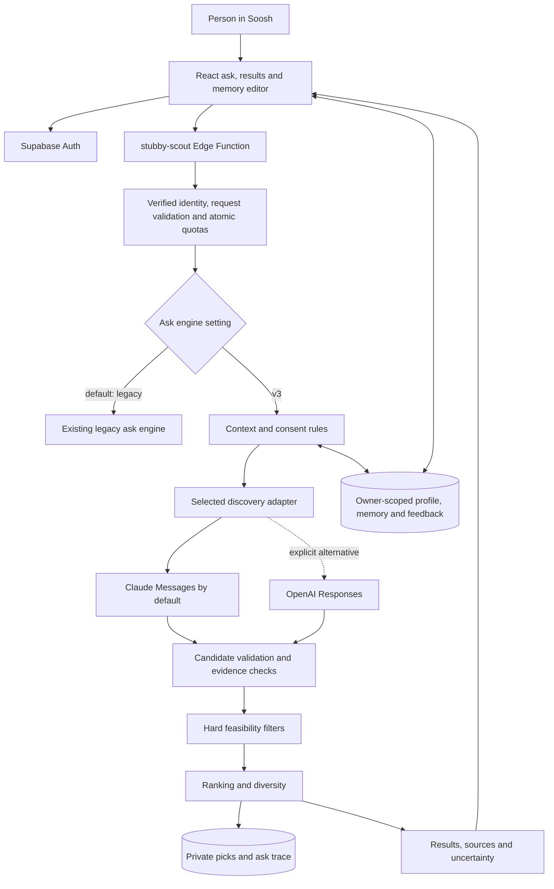

# Stubby: product, architecture and change guide

This is the consolidated guide to Stubby's V3 work in Soosh. It explains what
changed, how a request runs, what information Stubby uses, how Claude billing
works, and what remains before release.

**Current status:** implemented and tested locally on
`feature/stubby-context-v3`; not deployed or enabled in production. The reviewed
code is `275dcea`, with findings in [the compatibility review](compatibility-review.md).
The local suite passed **2,050 tests**. Live Claude and hosted Supabase validation remain outstanding,
so this is a working foundation rather than completion of the full V3 brief.
The implementation contract version is `stubby-v3.3`; the product is called
Stubby 3.0.

The branch has been pushed. A PR has **not** been created: this cloud
environment currently blocks `api.github.com`. A network configuration draft
was saved for review, and the intended PR is a draft targeting `main` with the
marker **DO NOT MERGE — OWNER APPROVAL REQUIRED**.

## Contents

1. [What Stubby does](#1-what-stubby-does)
2. [What changed](#2-what-changed)
3. [Architecture](#3-architecture)
4. [A request from start to finish](#4-a-request-from-start-to-finish)
5. [Understanding the request](#5-understanding-the-request)
6. [Finding, checking and ranking recommendations](#6-finding-checking-and-ranking-recommendations)
7. [Memory, consent and deletion](#7-memory-consent-and-deletion)
8. [Claude, credits and configuration](#8-claude-credits-and-configuration)
9. [Security, privacy and operating limits](#9-security-privacy-and-operating-limits)
10. [Code and database map](#10-code-and-database-map)
11. [Testing and review results](#11-testing-and-review-results)
12. [Remaining work and release sequence](#12-remaining-work-and-release-sequence)

## 1. What Stubby does

Stubby helps a person find an activity that fits what they want to do, when they
are free, where they are looking, and what they can spend. It sits in Soosh's
existing ask, picks and calendar experience.

V3 combines a selected AI provider for discovery and extraction with ordinary
TypeScript rules for feasibility and ranking. The model proposes candidates;
the application decides which candidates satisfy the checks it implements.

An ask can return up to three private recommendations, with source links and
uncertainty notices. If no candidate passes, Stubby returns an honest fallback.
Users retain the existing actions to save a pick or follow up. Stubby has no
tool for buying tickets, booking a venue, sending a message or automatically
sharing a personal recommendation.

For example, consider this illustrative ask:

> “Pottery in New York tonight, indoors, no more than $20.”

Stubby derives the local evening window, the city, a pottery topic, an indoor
setting and a hard $20 ceiling. It searches, extracts candidates, and rejects
those with the wrong city, an incompatible time, an unknown price or a maximum
price above $20. Any web-derived recommendation remains **partial** and asks the
user to confirm details. This example describes the rules; it is not a claim
that a matching live event was found.

## 2. What changed

The earlier implementation already had Claude discovery, authentication,
onboarding, personal picks, guest limits, follow-ups and an admin/restock flow.
V3 builds on those foundations.

| Area | Existing foundation | Change in this branch |
| --- | --- | --- |
| Ask engine | Legacy ask flow | An opt-in V3 orchestrator; legacy remains the default |
| Provider | Existing Anthropic credentials and scout | Claude-backed V3 by default; explicit optional OpenAI adapter |
| Personal context | Corners, free windows, budget, city and passes | Separate consented memory for timezone, activity budget, equipment, goals, preferences and memberships |
| Understanding | Legacy intent/window parsing | Bounded rules for decimal budgets, exclusions, supported cities, settings and timezone-aware windows |
| Discovery | Existing search flow | Shared candidate schema, strict runtime validation and actual-search URL provenance |
| Feasibility | Existing result checks | Deterministic hard constraints for time, cost, city, setting, resources, age and other supported facts |
| Ranking | Existing personal signals | Explicit scoring, consent-gated feedback, duplicate suppression and topic diversity |
| Confidence | Existing result states | Additional `verified`, `partial` and `no_verified_match` intelligence outcomes |
| Memory controls | Existing onboarding edits | Flagged memory editor, separate consent switches and atomic extension/feedback deletion |
| Diagnostics | Existing ask records | Versioned, bounded decision traces with reason counts, sources and provider usage |
| Verification | Existing test suite | V3/provider/security scenarios, deterministic evaluation and local SQL/browser checks |

The review also fixed budget negation such as “no more than $20 on pottery,”
unknown named destinations falling back to the saved city, and gear/bikes being
treated as memberships. It preserved the capability-profile work already on
the remote branch, including its public contracts and original tests, through
a merge rather than overwriting that history.

There is no new application runtime dependency, separate AI service or hosting
platform. Package manifests, lockfiles, `.env` files and historical migrations
were left unchanged.

## 3. Architecture



The frontend uses React, TypeScript, Vite, Tailwind and the existing router.
Supabase supplies authentication, Postgres with row-level security, and the
`stubby-scout` Edge Function. The static frontend continues to use the existing
deployment setup.

V3 has one orchestrator and one selected model provider. Its context, discovery,
evidence, feasibility and ranking components are TypeScript modules. They are
not separate autonomous agents.

The existing handler continues to own identity, guest readiness, request
validation, atomic quotas, streaming responses and persistence. The new modules
are under [`supabase/functions/stubby-scout/v3/`](../../supabase/functions/stubby-scout/v3/).
The composition root, [`index.ts`](../../supabase/functions/stubby-scout/index.ts),
wires the real clients and selected provider.

Weather and calendar have typed adapter ports and tested failure behavior.
Those ports currently have no live provider wired into the application.

## 4. A request from start to finish

```mermaid
sequenceDiagram
    participant UI as Soosh
    participant H as Edge handler
    participant DB as Supabase
    participant V as V3 pipeline
    participant AI as Selected model API
    UI->>H: Authenticated ask and current-turn answers
    H->>DB: Verify caller; read permitted personal context
    Note over H,DB: A needed clarification returns before an ask is claimed
    H->>DB: Atomically claim ask or eligible free follow-up
    H->>V: Request, server time and consented context
    V->>V: Build constraints; stop early on invalid context
    V->>AI: Research with coarse public constraints and web search
    AI-->>V: Research text and actual source URLs
    V->>AI: Tool-free structured extraction with permitted context
    AI-->>V: Candidate JSON
    V->>V: Validate, filter, deduplicate and rank
    V-->>H: Up to 3 picks, confidence, warnings and usage
    H->>DB: Save private picks and bounded ask trace
    H-->>UI: Existing JSON/SSE contract plus intelligence notice
```

1. The handler validates the request and checks verified identity, feature/key
   readiness and the existing access rules. Identity comes from the verified
   caller, not a user ID asserted in the request body.
2. For V3, it reads the caller's private memory extension. Original onboarding
   and feedback enter the pipeline only under their respective consent choices.
   A guest can use the city they explicitly supplied in quick context, but
   cannot save the durable memory extension.
3. A vague request may receive one clarification before model work or ask quota
   consumption. A status-only request also does not run discovery.
4. The existing database mechanism atomically claims an ask, or the first
   eligible free follow-up for an account.
5. V3 builds context from the server clock, selected timezone, current request
   and permitted saved information. Invalid time, unsupported currency or an
   unrecognized named destination can produce a fallback without a model call.
   This occurs **after** the ask claim, so it can still consume an ask.
6. Discovery runs its two model phases. Candidates then pass runtime validation,
   evidence checks, hard filters, deduplication and ranking.
7. The handler saves successful recommendations to `personal_picks`. V3 does not
   publish them to `city_picks`. The existing legacy restock process remains a
   separate path that can publish eligible public picks.
8. The response retains the existing outer `found`/`nothing` behavior and adds
   optional `intelligence` with outcome, warnings and fallback. The frontend
   shows the notice and loads the person's saved picks.
9. A normal charged ask records its bounded decision trace in
   `stubby_asks.decision_trace`. A free follow-up keeps the existing trace
   behavior rather than creating an independent replacement trace.

The existing SSE channel remains in use. V3 does not stream every native search
query or the model's internal reasoning. The existing Stop control stops the
client listening; server work may still finish and the ask may still count.

## 5. Understanding the request

**Current explicit instructions take precedence over saved defaults.** Stored
preferences and feedback are soft signals; they must not override what the
person explicitly asks for now.

| Input | Implemented behavior |
| --- | --- |
| Budget | Recognizes supported US-dollar phrasing, decimals and thousands separators; distinguishes free admission from “I'm free” |
| Hard spending ceiling | Requires known USD maximum total cost within the ceiling; rejects unknown price |
| Saved budget | Per-activity budget is soft; otherwise monthly budget divided by four is a soft ranking heuristic |
| Time | Supports named day parts, dates and supported clock ranges, with IANA timezone handling |
| Tonight | Starts at 17:00 local, or now if later, within the derived evening window |
| Daylight saving | Handles 23/25-hour days; ambiguous or nonexistent explicit wall times cause abstention |
| City | Supports known cities and New York aliases; a current recognized city overrides the saved one |
| Unknown destination | An unrecognized named destination can trigger city confirmation instead of silently using home |
| Topics | Supports bounded activity vocabulary, public Corner names, synonyms, specificity and exclusions |
| Setting | Distinguishes at home, indoors, outdoors and away from home |
| Equipment | Current-turn declarations can add a resource; “no longer have” can remove a saved resource |

The parser is deterministic and vocabulary-bound. It is not arbitrary global
geocoding, multilingual understanding or a guarantee that every natural-language
condition is understood. It does not convert currencies or maintain a ledger
of actual spending. “Monthly budget / 4” is not a claim about money remaining.

Account follow-ups retain their existing quota rules. V3's “Cheaper” lowers the
ceiling, “Closer” applies a 20-minute travel ceiling, and “Later” moves the
earliest start forward by two hours. Previously shown titles are excluded from
subsequent suggestions. If a stricter condition cannot be established, the
follow-up can return no match. Guests are asked to sign up for follow-ups.

## 6. Finding, checking and ranking recommendations

### Two model phases

**Research** receives coarse search constraints: clock/window, timezone, city,
supported activity topics and exclusions, family requirements, budget and
setting. It has the provider's hosted web-search tool.

The research payload excludes raw asks, private goals and preferences, owned
equipment lists, feedback, calendar details and personal identifiers. This
limits what is sent to the search tool; the chosen model API still receives
permitted private context in the next phase.

**Extraction** receives the request, consented context and research as JSON
data. It has no tools and must return the shared candidate JSON schema. Claude
uses `output_config.format`; optional OpenAI uses strict `text.format`.

Both adapters validate actual field types, unexpected fields, timestamps and
calendar-valid dates. Candidate URLs must come from the actual research source
or citation set. A model cannot mark its own search output as independently
verified. Candidate records contain the activity, place/city, times, cost,
setting, requirements and source evidence.

### Hard feasibility checks

Before ranking, V3 rejects candidates that fail any applicable supported rule:

- Missing, unsafe, future-dated or more-than-24-hours-old source checks; event
  index/listing pages; cancelled or sold-out activities.
- Starts in the past or outside the requested window; invalid, excessive or
  out-of-window duration. A hard time window requires a known end time.
- An unknown/non-USD/over-limit price when a hard dollar ceiling was supplied.
- Wrong setting or wrong/missing city for an activity away from home, including
  an activity idea rather than a ticketed event.
- Unknown or excessive travel when a travel ceiling is explicit, or known
  travel that cannot fit before the start.
- Incompatible age requirements, unverified adult eligibility, or adult-only
  content without an explicit adult request. Family requests require known
  suitable age policy and reject starts at or after 20:00 local.
- An excluded topic, failure to match an explicit supported topic, missing
  required equipment, or a membership-based eligibility requirement.
- Overlap with a known busy interval, or known unsafe weather for outdoors.

Self-reported memberships never prove admission, discounts or eligibility.
Unknown details can create a warning or reject a candidate when they are needed
to meet a hard condition. For example, unknown travel warns on an ordinary ask
but fails an explicit travel ceiling. Unknown weather warns for outdoors.

The 24-hour evidence limit refers to **when the source was checked**. It does
not independently prove that the page's price, availability or event details
were recently updated.

### Ranking and confidence

Only feasible candidates receive a score. The implemented scoring is explicit:

| Signal | Score contribution |
| --- | --- |
| Base | 40 |
| Usual weekly free slot | +4 |
| Supported topic overlap with goals/preferences | +3 |
| Independently verified candidate | +20 |
| Matching interest tags | +5 each, up to +15 |
| Within the soft activity budget | +10 |
| Uses required equipment the person has | +5 |
| Consented feedback affinity | Up +6, save +8, down −15; sum clamped to −25…+15; suppressed for an explicit current topic |
| No matching learned history | +3 |

Duplicate titles at the same start are removed after feasibility checks, with
stronger valid evidence preferred. Selection takes at most three results,
prefers verified results over partial results, and diversifies the leading
topic within each confidence group before filling remaining places. Ties use
stable time and ID ordering. The current explanation text is deliberately
simple; this is not a rich generated explanation engine.

| Outcome | Meaning in this implementation |
| --- | --- |
| `verified` | Trusted structured-provider evidence and all applicable checks pass without warnings |
| `partial` | A candidate passes the implemented hard checks but has search-derived evidence or unresolved details |
| `no_verified_match` | No usable recommendation survives; return an honest fallback |

**Current live-provider design produces partial web-derived recommendations.**
There is no configured independently verified structured feed. A partial result
can still be useful, but users must confirm details before going. The V3 path
does not silently relax a hard time window to offer another date.

## 7. Memory, consent and deletion

Original onboarding stays in its existing tables. V3 adds an optional private
extension and keeps the earlier read-only capability bridge compatible.

| Data | Storage/use |
| --- | --- |
| Corners, weekly windows, monthly budget, city/area | Existing `profile_private`; imported into V3 only with memory and onboarding consent |
| Passes, access and gear | Existing `user_passes`; kinds preserved, gear/bikes classified as equipment, memberships self-reported |
| Guest quick context | Existing `stubby_profiles`; V3 currently uses the submitted city, not every guest taste field |
| V3 memory extension | New `stubby_capabilities`, one row per non-anonymous account |
| Up/down/save feedback | Existing `stubby_feedback`; newest 20 entries from the last 60 days, only with memory and feedback consent |
| Recommendations | Existing `personal_picks`, private to the person |
| Decision diagnostics | Existing owner-only `stubby_asks.decision_trace` |

The extension stores version 1, timezone, optional per-activity budget,
equipment, goals, explicit preferences and memberships with optional expiry.
Membership status is always `self_reported`. Lists and text lengths are bounded;
the database also caps the JSON at 20,000 bytes. There are no membership numbers
or precise GPS coordinates in this contract.

Three consent choices start **off**:

1. **Memory:** permit V3 to use the extension's saved personal context.
2. **Onboarding:** additionally permit use of original onboarding information.
3. **Feedback:** additionally permit use of explicit up/down/save history.

Onboarding and feedback consent only take effect when memory consent is also
on. Consent controls V3's data use; the legacy engine retains its existing
behavior. Turning consent off stops the relevant V3 use but does not itself
physically delete the saved row.

With `VITE_STUBBY_V3=true`, the editor appears in onboarding and the account
page. It supports viewing, editing, saving and confirmed deletion. Original
onboarding answers remain editable through the existing onboarding route.
Invalid/unreadable extension data fails closed; the UI reports read/save errors
instead of presenting a failed load as a successful empty profile.

**Forget memory** calls `forget_stubby_memory(expected_user)`. In one
caller-scoped transaction it deletes the caller's extension and feedback. The
expected account must match verified identity, protecting against account
switches while the editor is open. This action does not delete original
onboarding, existing picks or past ask traces. Account deletion cascades to the
extension. There is no new background learning job or automatic memory writer.

The 60-day feedback window is a limit on what V3 reads, not an automatic database
retention/deletion policy. The extension remains until changed or deleted.
V3 does not currently ingest all Pursuits or connect a live external calendar.

## 8. Claude, credits and configuration

**Yes: V3 is wired to reuse the existing Anthropic API key and optional workspace,
so calls can be billed against that API account's available credits.** This is
API billing; a Claude consumer subscription is a separate product. No account
balance, entitlement, live charge or real model request was verified here.

Claude requests go to `https://api.anthropic.com/v1/messages`, reusing the
existing authentication/version/workspace contract. The selected model must
support both hosted web search and JSON-schema structured outputs.

| Setting | Behavior |
| --- | --- |
| `STUBBY_SCOUT_ENABLED` | Existing kill switch; must be `true` to allow work |
| `STUBBY_ASK_ENGINE` | Unset/other values use legacy; exact `v3` selects the new ask path |
| `VITE_STUBBY_V3` | Build-time frontend flag; exact `true` exposes the memory editor |
| `STUBBY_V3_PROVIDER` | Unset defaults to `anthropic`; explicit `openai` selects OpenAI; unknown values fail closed |
| `ANTHROPIC_API_KEY` | Reuse existing server-side Claude key |
| `ANTHROPIC_WORKSPACE_ID` | Reuse existing optional workspace |
| `STUBBY_CLAUDE_MODEL` | First-choice V3 model override |
| `STUBBY_SCOUT_MODEL` | Claude model fallback when the V3 override is absent |
| Claude final fallback | `claude-haiku-5-5`, matching the existing scout default; live account compatibility still needs checking |
| `OPENAI_API_KEY` | Required only for explicitly selected OpenAI |
| `STUBBY_OPENAI_MODEL` | Optional OpenAI override; default `gpt-4.1` |

Existing Supabase bindings, approved origins, guest salt and quota settings are
also required. Keep both V3 flags off for a legacy rollout; enable both in the
approved test environment when validating V3. Frontend flags require a rebuild.

Neither a missing Claude key nor a credit/authentication error, timeout or
malformed response can silently trigger OpenAI spending. There is no automatic
cross-provider fallback. Admin and restock retain their existing Anthropic
paths, independently of the V3 ask-provider selection.

Reuse existing deployed server secret bindings. Model-provider keys must never
be placed in frontend variables or pasted into chat. OpenAI requests set
`store:false`; Claude does not receive an unsupported `store` field. Actual
provider retention depends on the account's settings and policy; this code does
not establish zero retention.

See [the provider guide](claude-provider.md) and
[the environment/rollout guide](environment-and-rollout.md) for setup details.

## 9. Security, privacy and operating limits

Supabase authentication, owner-scoped reads and row-level security protect
personal records. Anonymous accounts cannot access the memory extension. Its
table has both owner and restrictive isolation policies. The deletion function
uses caller permissions and explicitly checks the expected account.

The service-role client is used for the handler's controlled quota/persistence
operations. It is not sent to the browser or exposed to the model. Request
bodies reject unexpected fields, provider responses are size-bounded, and
provider error bodies are not echoed to users.

Web content and private context are treated as data. Tool choice is fixed;
extraction has no tools. Runtime schema/provenance/feasibility checks enforce
boundaries beyond prompt instructions. Source links require safe HTTPS URLs,
without embedded credentials, local/private IP literals or unusual ports. They
are navigation links; the backend does not fetch arbitrary source URLs itself.

The new decision trace records versions, outcome/counts, rejection reason totals,
token usage and selected source URLs/check times/verification. It does not add
raw asks, profile values or feedback to that trace. This describes the new trace,
not a blanket promise about every pre-existing ask field or provider log.

### Default quota settings

These are server defaults, not promises about deployed configuration. Existing
daily caps are enforced through atomic database claims over rolling windows.

| Setting | Default | Maximum configured value |
| --- | --- | --- |
| Account asks: `USER_DAILY_MESSAGE_LIMIT`, else `STUBBY_ASKS_PER_PERSON` | 6 | 50 |
| Overall asks: `STUBBY_ASKS_PER_DAY` | 200 | 5,000 |
| Guest asks: `GUEST_DAILY_MESSAGE_LIMIT` | 3 | 20 |
| Guest asks per IP: `GUEST_IP_DAILY_LIMIT` | 9 with default guest limit | 100 |
| New guests per IP/hour: `GUEST_NEW_PER_IP_HOUR` | 5 | 50 |
| Overall guest asks: `GUEST_GLOBAL_DAILY_CAP` | 60 | 2,000 |

The first eligible account follow-up is atomically free under the existing
rule; later follow-ups use asks. The guest-per-IP default is three times the
configured guest ask limit. These limits do not guarantee a dollar spend cap.

### Provider and runtime bounds

- Two model phases, with at most three HTTP calls total including retries. A
  phase can retry a transient status once only within that total call budget.
- At most two hosted searches per research attempt, or the lower configured
  server limit. A retried research call can incur charges again.
- Research/extraction output limits of 2,500/4,000 tokens, response bodies of at
  most 200,000 bytes, and at most 10 model-produced candidates.
- The V3 context/discovery orchestration has a 35-second default deadline and a
  45-second maximum injected deadline. This is not an end-to-end database/UI
  latency guarantee.
- Generic discovery is bounded to three adapters and 100 candidates per adapter;
  the actual selected model adapter has the tighter 10-candidate limit above.
- Refusals, truncation, unexpected tools and unsupported continuation responses
  fail honestly. There is no autonomous continuation loop or background search.

Usage records include returned token counts and Claude cache-related input
counts where supplied. They are not measured dollar charges. Live latency,
search charges, model access and provider spend controls still need validation.

## 10. Code and database map

| Location | Responsibility |
| --- | --- |
| [`AskStubby.tsx`](../../src/app/components/stubby/AskStubby.tsx), [`StubbyResults.tsx`](../../src/app/components/stubby/StubbyResults.tsx) | Ask interaction and result/intelligence presentation |
| [`stubbyAsk.ts`](../../src/app/lib/stubbyAsk.ts) | Frontend request/response contract and stream handling |
| [`CapabilityEditor.tsx`](../../src/app/components/settings/CapabilityEditor.tsx) | Consent and private-memory controls |
| [`capabilityProfileRemote.ts`](../../src/app/lib/capabilityProfileRemote.ts) | Verified-owner read/save/delete operations and preserved onboarding bridge |
| [`_shared/capabilityProfile.ts`](../../supabase/functions/_shared/capabilityProfile.ts) | Strict private-extension contract and parser |
| [`_shared/onboardingCapability.ts`](../../supabase/functions/_shared/onboardingCapability.ts) | Preserved read-only onboarding capability contract and resource classification |
| [`index.ts`](../../supabase/functions/stubby-scout/index.ts), [`handler.ts`](../../supabase/functions/stubby-scout/handler.ts) | Dependency wiring, routing, identity, quota, SSE and persistence |
| [`v3/types.ts`](../../supabase/functions/stubby-scout/v3/types.ts) | Versioned request, context, candidate, adapter and report types |
| [`v3/request.ts`](../../supabase/functions/stubby-scout/v3/request.ts), [`v3/context.ts`](../../supabase/functions/stubby-scout/v3/context.ts) | Constraint parsing, timezones, context and consent precedence |
| [`v3/provider.ts`](../../supabase/functions/stubby-scout/v3/provider.ts) | Single source of truth for provider, key and model selection |
| [`v3/anthropic.ts`](../../supabase/functions/stubby-scout/v3/anthropic.ts), [`v3/openai.ts`](../../supabase/functions/stubby-scout/v3/openai.ts) | Bounded provider-specific research/extraction calls |
| [`v3/modelContract.ts`](../../supabase/functions/stubby-scout/v3/modelContract.ts) | Shared prompts, schema, private/coarse payloads and output normalization |
| [`v3/discovery.ts`](../../supabase/functions/stubby-scout/v3/discovery.ts), [`v3/evidence.ts`](../../supabase/functions/stubby-scout/v3/evidence.ts) | Adapter validation, safe sources and confidence |
| [`v3/feasibility.ts`](../../supabase/functions/stubby-scout/v3/feasibility.ts) | Deterministic hard checks |
| [`v3/recommendation.ts`](../../supabase/functions/stubby-scout/v3/recommendation.ts) | Scoring, duplicate handling and diverse selection |
| [`v3/orchestrator.ts`](../../supabase/functions/stubby-scout/v3/orchestrator.ts) | Pipeline, deadline, context-adapter failures and final outcome |
| [`evals/stubby/`](../../evals/stubby/) | Frozen scenarios, provider/integration tests and recorded evidence |

The additive migration is
[`20261112000000_stubby_capabilities.sql`](../../supabase/migrations/20261112000000_stubby_capabilities.sql).
It creates the extension table, consent/size checks, owner RLS and deletion RPC,
and registers their narrow access. The RPC requires an `expected_user` argument.

The matching
[rollback](../../supabase/migrations/rollback_20261112000000_stubby_capabilities.sql)
and
[hosted verification script](../../supabase/verification/stubby_capabilities_check.sql)
are checked in. The table/RPC are also registered in the repository's access
allowlist. No live migration has been applied as part of this work.

## 11. Testing and review results

These are the latest **recorded checks of the reconciled code**, summarized in
[`compatibility-review-report.json`](../../evals/stubby/compatibility-review-report.json).
They should be distinguished from live integration evidence.

| Check | Recorded result and scope |
| --- | --- |
| Full suite | 2,050 passed, 0 failed, 0 skipped across 218 files |
| V3/capability subset | 186 passed across 9 files, including preserved earlier tests |
| Frozen golden evaluation | 46/46 expected outcomes; compares actual legacy/V3 deterministic checks, not live model quality |
| Type checking | Frontend/backend strict TypeScript passed |
| Edge entrypoint | Deno 2.9.6 check passed using an offline alias to installed Supabase npm types |
| Builds | Default and V3 browser-test builds passed |
| Browser | Chromium guest asks/limit/signup return and memory save/reload/delete passed with mocked Supabase and OAuth |
| SQL | Local PostgreSQL WASM migration repeatability, RLS, invalid consent, cross-user denial, stale-account deletion, actual deletion and rollback passed using synthetic Auth fixtures |
| Repository checks | Lint, whitespace, copy/privacy/access checks and migration comparison against freshly fetched `origin/main` passed |
| Secrets/dependencies | No real candidate keys found in the reviewed pattern scan; environment files, manifests and lockfiles unchanged |

Review covered auth, quota concurrency, consent, account switching, private
storage, provider selection, retries, source provenance, malicious source text,
strict outputs, DST, budgets, membership/age rules and frontend compatibility.
The reviewed code had no additional unresolved critical local regression.

This does **not** verify live Anthropic credits or model/search support, real
OAuth, full hosted Supabase schema compatibility, production quality, live cost
or latency. The browser/SQL mocks and fixtures are intentionally isolated.

For reproducible commands and report meanings, see the
[evaluation README](../../evals/stubby/README.md). Basic local checks include:

```sh
npm ci
npm test -- --maxWorkers=4
npx vitest run evals/stubby --maxWorkers=4
npm run build
npm run lint
```

The focused V3 command is useful during iteration; it is already part of the
full suite. The evaluation README also documents browser, isolated SQL and
offline Deno checks. Earlier review reports are historical snapshots; use
`compatibility-review-report.json` for the latest complete local count.

## 12. Remaining work and release sequence

| Area | Current state / next evidence needed |
| --- | --- |
| Claude API credits and compatibility | Wiring implemented; real account, model, hosted search, structured output and usage unverified |
| Hosted database/auth | Local migration/RLS/deletion tests pass; approved test-project validation outstanding |
| Weather | Typed port and failure tests; no live provider |
| Calendar availability | Typed port and conflict checks; no live external calendar connection |
| Travel | Hard rules exist; current model adapters provide unknown travel, so strict travel requests may return none |
| Verified events, opening/admission facts | No configured independently verified feed; web evidence remains partial |
| Benefits/membership eligibility | Self-report only; no eligibility or discount verification provider |
| Trends/social discovery | No configured trend provider or Instagram/TikTok/Pinterest/YouTube scraping integration |
| General language understanding | Bounded rules and scenarios; broader interpretation and live quality evaluation remain |
| PR/CI | Branch pushed; GitHub API access blocks PR creation and inspection of final hosted checks |

The next release steps are concrete:

1. Use an approved isolated Supabase test project. Confirm its identity and
   inspect its existing schema before any remote write. Reuse server-side
   Anthropic bindings and choose a compatible model.
2. Review/apply the additive migration there and run the hosted verification
   script with test users. Verify real owner isolation, consent, deletion and
   signup behavior against the complete schema.
3. Deploy the Edge Function and a test frontend with both V3 flags enabled.
   Run real guest/member asks and adversarial cases; measure source accuracy,
   model compatibility, latency and actual provider usage/cost.
4. Resolve or explicitly scope the unconfigured providers and interpretation
   gaps. Record which product promises the release can support.
5. Apply the saved GitHub network configuration, create the draft PR targeting
   `main`, and check hosted CI and mergeability on the final head. Owner review
   is required before merge. Repository CI notes that merging main can trigger
   production database deployment.

For rollback, set `STUBBY_ASK_ENGINE=legacy` and rebuild with the frontend V3 flag
off. `STUBBY_SCOUT_ENABLED=false` is the existing immediate kill switch. The
unused extension can remain. Applying its SQL rollback is a separate destructive
operation that deletes extension data; it leaves original onboarding, passes,
picks and legacy tables intact.

More detailed supporting records are available in the
[architecture](architecture.md), [security](security.md),
[final audit](final-audit.md) and [PR review](pr-review.md) documents.
