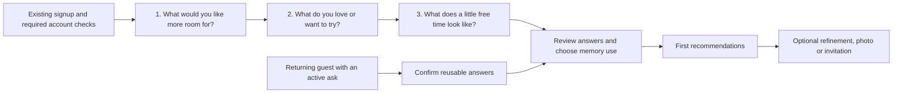

# Onboarding review and redesign proposal

**Recommendation:** give Stubby a small, reliable starting profile, show a useful
recommendation quickly, then ask for more information when it can change the
next recommendation. Every question needs a defined consumer in the engine.

**Product direction:** start with what someone wants more room for in everyday
life. Soosh includes staying home, small personal projects, regular practice,
quiet breaks and doing things with others. Going out is one possibility. The
initial questions should feel like getting to know someone; prices, location
and exact scheduling belong where they become relevant to a suggestion.

This is a proposed design for `feature/stubby-context-v3`, informed by the earlier
source-code review below. Subsequent branch work has changed V3 consent and
routing; refresh those technical findings before using them as an implementation
plan. This proposal does not change onboarding screens, database policy or the deployed product.
New fields and behavior below are proposals unless explicitly described as
current. The V3 release still has the live-validation gaps in the
[Stubby guide](guide.md).

Review validation: **70 tests passed across three files** covering the current
taste screens, first-plan matcher and V3 reasoning. These checks confirm the
existing behavior; they do not demonstrate a conversion or recommendation-quality
improvement for the proposed flow. No fresh browser usability study was run.

## What the reviewed onboarding collects

The main route has twelve named steps:

`Welcome → Signup → Code → Name → Birthday → Where → Picks → Free → Yours → Card → Plan → Invite`

Some paths skip steps, and email signup can show an additional password offer
within Name. Only Picks, Free and Yours appear in the “1 of 3” taste progress
indicator. This count is not a measurement of the entire signup journey.

| Current screen | Information collected | Current recommendation use |
| --- | --- | --- |
| Name/Birthday | Display name, username, private birthdate | Identity and age eligibility; exact birthday is not needed by discovery |
| Where | Neighborhood or city; optional browser location resolved locally to a New York neighborhood | City/area stored; V3 currently uses city rather than neighborhood-level travel |
| Picks | At least three Corners; invite Corner can start selected | First-plan topic eligibility; V3 interests when onboarding consent is enabled |
| Free | Fourteen weekly daytime/evening slots; skippable | First-plan start-window matching; V3 soft ranking preference |
| Yours | Pass/gear categories, optional place, monthly budget of free/$50/$100/$200 or skip | First-plan affordability/pass handling; V3 optional monthly/4 soft budget and self-reported membership context |
| Optional V3 memory editor inside Yours | Timezone, activity budget, equipment, goals, preferences, memberships, three consent switches | V3 reads permitted fields; use depends on explicit memory consent |
| Card | Avatar and member-card presentation | No activity-feasibility benefit; appears before the first plan |
| Plan/Invite | First activity choice and optional friend handoff | Existing first-plan matcher and explicit RSVP/join/create actions |

Keep the existing strengths: short copy, tappable choices, editable answers,
resume/back behavior, reduced-motion support, invite continuity, private budget
and birthday, optional location permission, and a concrete first-plan payoff.

## Findings that matter most

### 1. The first plan and V3 disagree about the same answers

`PlanScreen` calls `loadPlanInput` and `buildPlans`, rather than the V3 pipeline.
The older matcher accepts an activity price up to the monthly budget; V3 uses
monthly budget divided by four as a soft preference. The old matcher treats a
skipped budget as free-only unless a pass is present; V3 treats absence of a
saved budget as unknown. A pass can bypass the old affordability check even
though its actual coverage is unverified. V3 rejects membership-required
candidates without verified eligibility.

Availability also differs: first-plan matching uses selected slots as filters
on starts, while V3 uses those weekly slots as a ranking boost. The first-plan
code uses browser-local time and an 18:00 evening boundary; V3's usual-window
ranking uses the selected timezone and a 17:00 boundary.

**Priority:** establish shared meanings for budget, windows, timezone and
eligibility. Use one context/feasibility contract for first-plan and later asks,
while retaining their separate presentation and explicit plan-making actions.
Internal Soosh events and Pursuits can be adapters into that contract; onboarding
does not need to make a paid web-search call for every result.

### 2. Answering questions does not clearly authorize their V3 use

V3 intentionally ignores saved onboarding without both memory and onboarding
consent. Those controls currently sit inside the optional, collapsed “What
Stubby knows” form. A person can complete the main questions without discovering
how those answers will be used by V3.

**Priority:** explain the benefit and choices in the main flow. Keep consent
explicit and off by default. Make “use for this request” distinct from “remember
for future recommendations”; request-only onboarding context needs implementation
and must not silently import the saved profile after someone declines consent.

### 3. The questions capture hobbies better than intent

“Pottery” does not tell Stubby whether someone wants a quiet solo activity, a
beginner class, new friends or serious practice. Requiring three interests can
also produce filler selections from someone who genuinely wants one thing.
Local activity ordering helps availability, but should not hide a person's
interests simply because local supply is low.

**Priority:** allow one interest, distinguish “already enjoy” from “curious to
try,” and ask for one optional primary outcome. Keep canonical Corner IDs,
search and invite context, without treating an invite-seeded Corner as proof
of a lasting preference.

### 4. Actionable constraints are missing or too indirect

Monthly spending is a poor proxy for what someone would enjoy doing. There is no normal
onboarding choice for session duration, travel tolerance, travel mode, experience
level or social format. Timezone is a raw text field in the optional editor.

**Priority:** start with interests, motivation and the person's usual rhythm.
Ask about spending, exact timing, duration, travel, level and format when a
suggestion needs them. Keep technical cost units in the data contract rather
than making them the language of onboarding. A new question
must ship with candidate facts and matching rules; adding a field to a prompt
alone does not establish that a recommendation meets it.

### 5. Resources are collected twice without a complete bridge

Yours stores generic pass/gear entries in `user_passes`; the V3 editor stores a
separate equipment list. V3 correctly removes gear/bikes from membership claims,
but `buildContext` does not add those original entries to its equipment list.
That list currently comes from the extension and explicit current-turn resources.
The generic “Gear” label is also insufficient to establish ownership of a guitar,
tent or paint set.

**Priority:** reuse existing answers, ask the person to clarify ambiguous gear,
and normalize confirmed resources once. Keep equipment separate from admission
benefits. Never infer free entry from a pass.

### 6. Save/skip behavior can weaken trust in the profile

The existing save helpers deliberately treat missing schema as success for
older-deployment compatibility. That is useful historically, but a new profile
flow must not claim information was remembered when nothing was stored.
Free's current “Skip for now” writes `null`, so revisiting and skipping can also
clear previously stored windows.

**Priority:** distinguish a saved answer, an explicit removal, an unanswered
question and a failed save. A skip should preserve an existing answer; provide
an explicit clear action. New-schema unavailability should leave people able to
continue without claiming successful persistence.

## Proposed first-use experience

Retain the current authentication, terms, age and account gates. Move optional
photo/card setup and invitation after a useful result. Preserve the existing
guest-first route: someone arriving from a live ask should return to that ask,
not be forced to restart a generic taste questionnaire.

Target roughly 60–90 seconds for the preference portion, excluding authentication.
This is a design target to test, not a measured completion time. Questions remain
skippable where the product can honestly work with unknown information. Ask a
clarification at recommendation time if an omitted fact is essential.

### Card 1: “What would you like to make more room for?”

- Offer warm, concrete choices: a little calm, making something, learning
  something, moving more, good company, or something new.
- Allow a couple of choices, an optional answer in their own words, or a skip.
  Do not frame the question as a productivity target or a life assessment.
- Treat the answer as an explicit preference. Wanting calm does not establish
  anxiety, wanting company does not establish loneliness, and curiosity does
  not establish beginner status.

**Benefit:** understand what a suggestion is for. Someone looking for calm might
enjoy drawing at the kitchen table; someone looking for company might enjoy
making something with others. Neither choice requires leaving home.

### Card 2: “What do you already love, or keep meaning to try?”

- Let someone choose one to five interests, with search and “I'm exploring.”
  Mix examples across home, local and shared experiences: reading, cooking,
  guitar, painting, walking, gardening and board games.
- Make “Already enjoy” and “Want to try” available as lightweight refinements,
  rather than making everyone complete a second interest inventory.
- Preserve existing Corners and invite context without forcing people to pick
  extra interests just to advance. Goal choices from the first card stay
  separate from these interests.
- For a relevant selection, allow one optional follow-up such as “Picking up
  guitar for the first time?” Avoid branching for every selected interest.

**Benefit:** distinguish established interests from curiosity and understand why
the activity matters. Level should be per activity; a person can be an expert
runner and a first-time potter.

### Card 3: “What does a little free time look like for you?”

- Offer small pockets of time, mornings, evenings, weekends, or “It changes.”
  Allow several choices or a skip. Do not assume a work schedule or that someone
  has whole evenings free.
- Make this about usual rhythm. A ten-minute practice, a quiet hour at home and
  a shared afternoon should all feel possible.
- Ask for an exact date/time only when needed for the current request. Usual
  rhythm is a soft preference, not proof of availability on a particular date.
- Keep detailed weekly grids, spending questions and travel planning out of the
  initial cards. Make them available when the person wants to refine a suggestion.

**Benefit:** learn how an idea could fit into everyday life without turning
onboarding into an appointment form. New rhythm choices still need an explicit
engine representation; they cannot be treated as implemented filters today.

### Practical details, when they help

Before searching nearby, ask “Where should I look?” and confirm city and
timezone. Keep typed entry available before location permission; no home address
is needed. A home-based idea need not prompt for a neighborhood. Travel limits
need routing evidence before they can be described as checked.

When cost matters, ask “Would you rather keep this free?” or “Anything you'd
like to stay under?” alongside the relevant suggestion or request. Keep skip and
custom amounts available. A skipped answer means unknown, not free-only.
Distinguish an explicit hard ceiling from a usual soft preference in the engine,
include known required fees, and clarify group cost only when necessary. Keep
monthly spending separate. These are contextual refinements, not core questions.

When resources matter, “Anything you already have that you'd like to use more?”
can surface a guitar, paints or a bike. Reuse confirmed information and ask
before remembering it; do not collect a complete inventory up front.

### Review: “Your starting preferences”

Show a compact editable summary of their interests, what they want more room
for, and their usual rhythm. Include practical details only if provided. For
example: “More time to make things. Curious about guitar. Little bits of time
in the evenings.” This is proposed summary copy, not an inference about their
personality or a claim that an exact time slot is free.

Offer separate, clearly explained choices to remember preferences, use existing
onboarding, and learn from explicit feedback. Preserve the current consent
dependencies while replacing technical labels with tested product copy.
Explain that permitted context is processed by the selected AI provider.
Continuing without memory must remain usable and must not enable feedback
learning. If request-only use is offered, handle it explicitly as current-turn
context with bounded lifetime; do not promise it is never logged or retained
without checking the existing ask/provider retention behavior.

Use interface captions and the current Stubby reactions. A redesign should not
introduce a talking onboarding character contrary to the existing product voice.
All example wording here is proposed copy, not a change to the approved glossary.

## Learn more after the first useful result

The next question should explain a mismatch or improve the current choice:

| Moment | Useful optional question | Resulting behavior |
| --- | --- | --- |
| New activity selected | “Beginner-friendly?” | Prefer sourced beginner suitability; do not invent skill requirements |
| A group event is offered | “Solo, with a friend, or open to meeting people?” | Match format and comfort without assuming relationship status or personality |
| A distant venue is rejected | “Too far just today, or usually?” | Separate one-request travel context from a confirmed lasting preference |
| An equipment-dependent idea is relevant | “What do you already have?” | Use specific confirmed equipment; suggest supplied/rental options only with known costs |
| A pick is rejected | Optional reason: price, time, distance, activity, or just today | Update the relevant dimension only after consent and appropriate confirmation |
| Access requirements matter | Optional practical needs such as step-free access | Require supporting venue evidence; unknown does not mean accessible |

Do not ask for diagnoses, income, exact address, contacts or payment information
to improve activity recommendations. Treat accessibility and similar information
as optional practical requirements with clear control and minimal disclosure.

Keep “Good pick,” “Not for me” and “Save.” A save is interest, not proof of
attendance; “Not now” is not permanent dislike. Ask before making a temporary
request a persistent preference. The existing feedback-consent switch remains
separate from using explicitly supplied preferences.

Offer one optional refinement at a time after results, with a skip/dismiss path.
Do not repeatedly ask a declined question or block the first recommendation on
completing a profile percentage.

## Connect the design to the engine

| Signal | Proposed consumer | Implementation needed |
| --- | --- | --- |
| City/timezone | Search scope and local windows | Reuse fields; confirm timezone; align first-plan/V3 semantics |
| Interest and curiosity | Retrieval, affinity and controlled exploration | Extend interest contract; separate explicit choice from invite seed |
| Primary outcome/social format | Candidate retrieval and ranking | Structured goal/format tags and sourced candidate metadata; current free-text goal matching is limited |
| Activity budget | Hard filtering or soft ranking according to the person's choice | Explicit budget mode; shared price logic for all recommendation paths |
| First date/time and usual week | First-request hard window versus recurring soft availability | Distinct fields/lifetimes and shared timezone-aware interpretation |
| Usual rhythm and small pockets of time | Prefer ideas that fit the person's available time | New rhythm/duration representation; never interpret a broad pattern as an exact free slot |
| Duration | End-time/duration checks | New constraint and explicit unknown-end handling |
| Travel mode/limit | Ranking or hard travel test | Structured preferences plus routing evidence; current model candidates have unknown travel |
| Experience level | Suitability ranking/filtering | Per-activity field and verified/unknown candidate suitability |
| Resources | Required-equipment checks | Normalize confirmed original gear into V3 equipment with consent |
| Practical access needs | Hard feasibility where required | New bounded contract, source facts and explicit unknown behavior |
| Feedback reason | Targeted preference correction | Extend explicit feedback contract, revocation/deletion and precedence tests |

The existing private-memory contract rejects unknown fields. Implement new
fields through a versioned parser/storage migration, not by hiding typed
requirements in free-text preferences or sending fields the current API rejects.
Expand the candidate schema, runtime validators, both provider adapters and
tests whenever a new filter depends on a new candidate fact.

Use this precedence: safety and verified eligibility first; then explicit
current-request constraints; then applicable saved hard requirements; then soft
preferences and consented feedback. A current override must be explicit and
limited to that request. It must never bypass safety or age eligibility.

Preserve original answers and remote capability APIs. Maintain provenance and
confirmation time for new signals; represent unknown separately from none.
Expire dated request context and ask people to reconfirm stale preferences
without inferring that silence means change. Apply owner-only access,
account-switch protection and the existing forget-memory behavior to any new
personalization fields or feedback extensions.

## Delivery order and evidence

1. **Make existing answers reliable.** Align first-plan/V3 budget, time and
   eligibility semantics; fix save/skip distinctions and the gear bridge. Add
   cross-path tests so the same constraints mean the same thing.
2. **Ship the short flow.** Reuse account gates, introduce the three core cards
   and visible consent/review, and defer avatar/invitation. Preserve guest chat,
   pending action, invite destination, account resume and back navigation.
3. **Add useful refinements.** Start with goals, beginner suitability and
   reasoned feedback. Only collect travel/access data when the app can either
   use it with evidence or clearly explain why it cannot satisfy the request.

Validate with realistic pairs: same pottery interest but different budget;
same budget but solo versus social intent; beginner versus experienced; an
explicit current request overriding a saved soft preference; and an unknown
travel/access fact under a hard requirement. A correct result can be no match.
Test consent off/revoked, failed save, resume, explicit clear, account switching,
timezone/DST, unsupported city and post-signup return as first-class cases.

Measure time to first useful result, completion/skip/error rates, and volunteered
fit ratings in a small test cohort. Compare against the current flow before
claiming improvement; 60–90 seconds is a target, not evidence. Evaluate hard-rule
violations separately from saves or clicks. Keep profile values, raw asks,
specific picks and feedback reasons out of third-party analytics. Respect the
repository's existing privacy restrictions on pick tracking; this proposal does
not add analytics events or a passive learning pipeline.

## Source map

- [Step order and gates](../../src/app/pages/onboarding/steps.ts),
  [flow/resume logic](../../src/app/pages/onboarding/OnboardingFlow.tsx)
- [Where](../../src/app/pages/onboarding/screens/WhereScreen.tsx),
  [Picks](../../src/app/pages/onboarding/screens/PicksScreen.tsx),
  [Free](../../src/app/pages/onboarding/screens/FreeScreen.tsx),
  [Yours](../../src/app/pages/onboarding/screens/YoursScreen.tsx)
- [Memory editor](../../src/app/components/settings/CapabilityEditor.tsx),
  [private-memory contract](../../supabase/functions/_shared/capabilityProfile.ts)
- [First-plan screen](../../src/app/pages/onboarding/screens/PlanScreen.tsx),
  [first-plan matcher](../../src/app/lib/firstPlan.ts),
  [first-plan reads/actions](../../src/app/lib/firstPlanRemote.ts)
- [V3 context](../../supabase/functions/stubby-scout/v3/context.ts),
  [hard checks](../../supabase/functions/stubby-scout/v3/feasibility.ts),
  [ranking](../../supabase/functions/stubby-scout/v3/recommendation.ts)
- [Save compatibility](../../src/app/lib/onboardingRemote.ts),
  [taste/pass reads](../../src/app/lib/tasteRemote.ts),
  [pick privacy tests](../../src/app/lib/pickPrivacy.test.ts)
